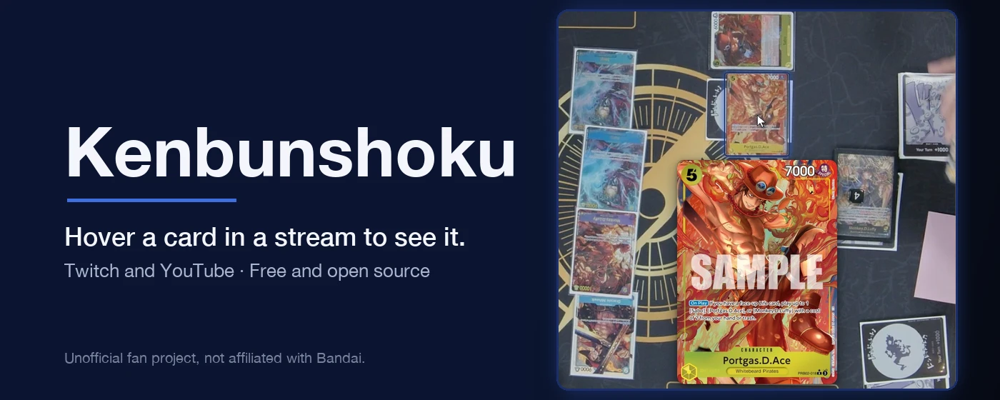
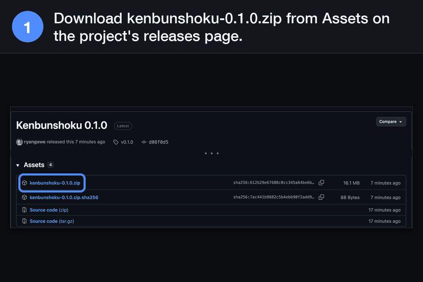
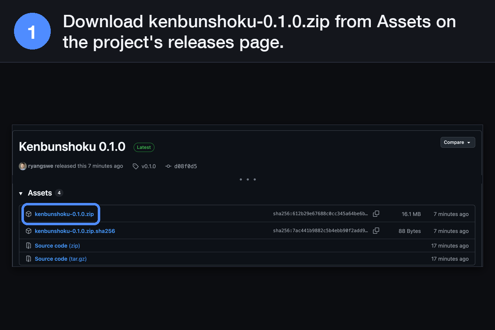
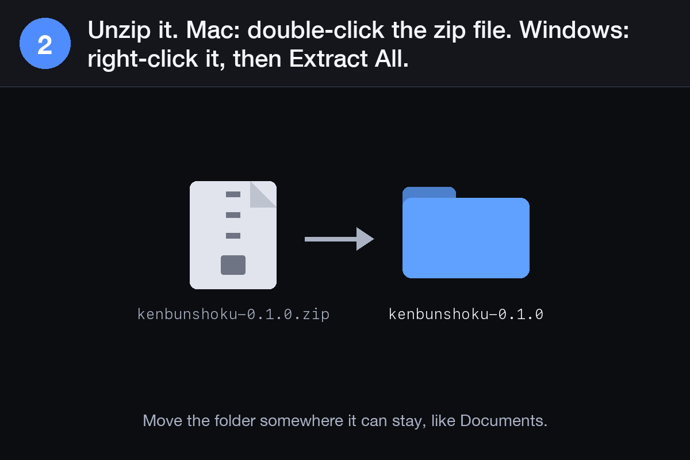
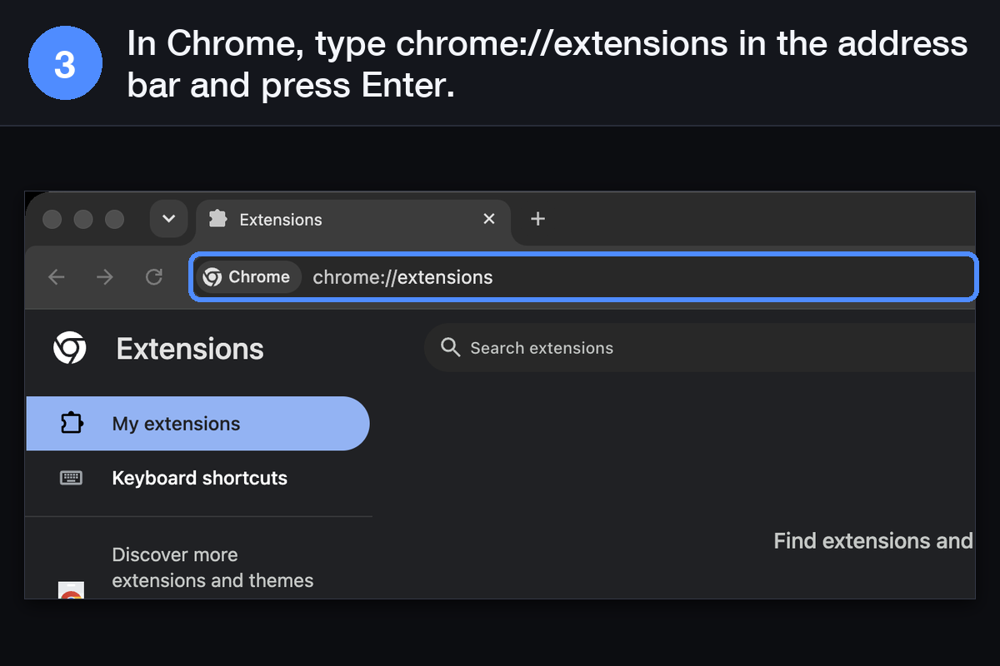
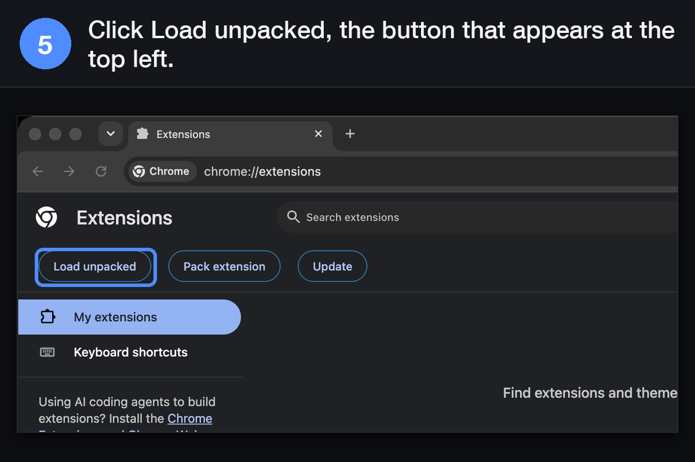
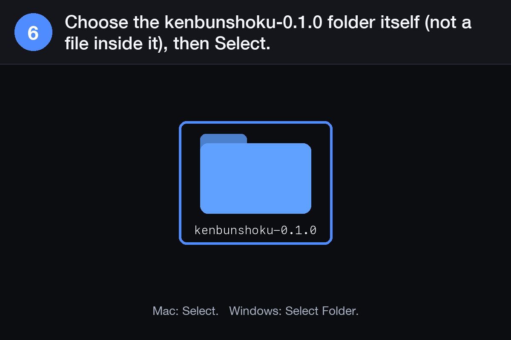
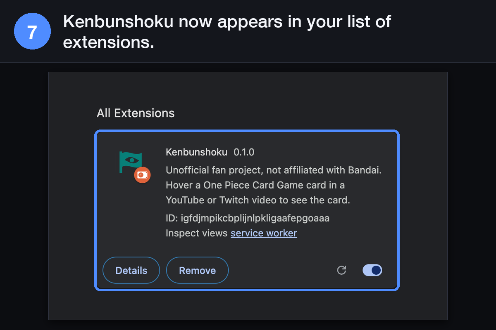
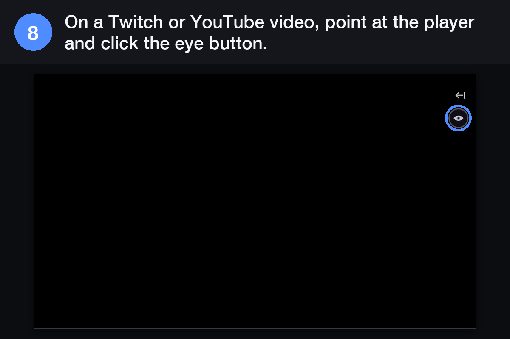
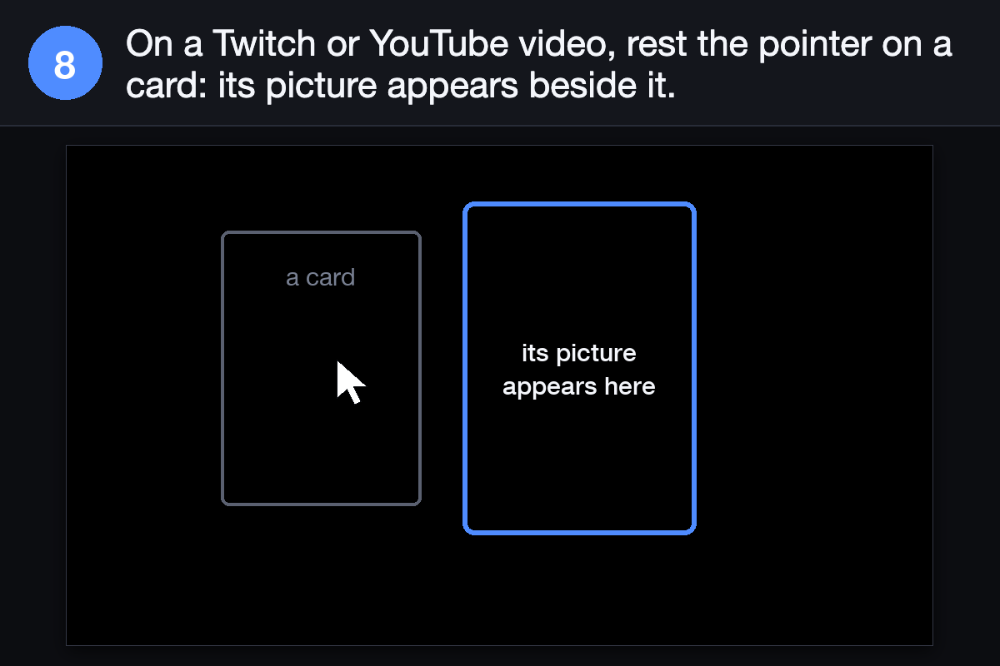

<!-- SPDX-License-Identifier: Apache-2.0 -->
*Kenbunshoku is looking for a maintainer. [Get in touch](https://github.com/ryangswe/kenbunshoku/issues) for more details!*

# Kenbunshoku

A Chrome extension for watching One Piece Card Game videos and streams. Hover a card in a
Twitch or YouTube video/stream and a larger, high resolution picture appears.

**Kenbunshoku is an unofficial fan project, not affiliated with Bandai.** The One Piece Card
Game, its card names and its card art belong to their owners.

## Install

The extension is installed from a zip file (2 minutes). A Chrome Web Store listing is coming soon.

1. Open the project's [releases page](https://github.com/ryangswe/kenbunshoku/releases) and,
   under the newest release, download the file named `kenbunshoku-<version>.zip`.

   

2. Unzip it: double-click the file on a Mac, or right-click it and choose **Extract All** on
   Windows. You get a folder named `kenbunshoku-<version>`. Move that folder somewhere it can stay,
   for example your Documents folder. Chrome loads the extension from it each time it starts, so
   do not delete it.

   

3. In Chrome, open a new tab, type `chrome://extensions` in the address bar and press Enter.

   

4. Turn on **Developer mode**, the switch in the top right corner of that page.

   

5. Click **Load unpacked**, the button that appears at the top left.

   

6. Choose the `kenbunshoku-<version>` folder from step 2 (the folder itself, not a file inside
   it) and click **Select**.

   

7. Kenbunshoku appears in the list. To keep its button in view, click the puzzle-piece icon to
   the right of the address bar, then the pin beside **Kenbunshoku**.

   

   

8. Open a One Piece Card Game video on Twitch or YouTube, point at the player and click the round
   eye button in its top-right corner to turn card hovers on for that channel. Then rest the
   pointer on a card: its picture appears beside it (see [Using Kenbunshoku](docs/using.md)).

   

   

Chrome may show a notice about extensions in developer mode when it starts. That is normal for
an extension installed this way; choose to keep it.

To update without losing your settings, or to remove it, see
[Updating and removing](docs/using.md#updating-and-removing).

## Documentation

| I want to… | Read |
| --- | --- |
| Learn how to turn card hovers on, what to expect, and how to update or remove it | [docs/using.md](docs/using.md) |
| See how accurate it is and what it does not recognize | [docs/accuracy.md](docs/accuracy.md) |
| Know what it reads, sends and keeps | [PRIVACY.md](PRIVACY.md) |
| Know why it asks for each permission | [docs/permissions.md](docs/permissions.md) |
| Understand how the extension and its settings file work | [docs/how-it-works.md](docs/how-it-works.md) |
| Build it from source, update the runtime or test on a local video | [docs/development.md](docs/development.md) |
| Make the same extension for another card game | [docs/make-it-yours.md](docs/make-it-yours.md) |
| Publish to the card-art CDN | [cdn/README.md](cdn/README.md) and [cdn/SETTINGS.md](cdn/SETTINGS.md) |

## Privacy

- **No accounts, analytics, telemetry or advertising.**
- **Video frames are never uploaded.** Pictures of the video are analyzed inside your browser,
  by the extension itself, temporarily in memory; they are not saved to storage.
- **Two hosts.** The extension makes requests to `cdn.kenbunshoku.com` and `optcgapi.com`, for
  a settings file, card pictures and, where Chrome has WebGPU, a card-feature file of about 60 MB
  downloaded on first use (the first video you turn card hovers on for) and cached. These
  requests carry no cookies, no account ID or per-user tracking identifier, and not the address
  of the page you watch.

[PRIVACY.md](PRIVACY.md) has the details, and [docs/permissions.md](docs/permissions.md) says
what each permission is for.

## Help

- Questions and help: the Discord channel, https://discord.gg/dsmmyU6RTG.
- Bug reports: GitHub Issues, https://github.com/ryangswe/kenbunshoku/issues.

## Built on cardvision

Kenbunshoku runs the Apache-2.0 cardvision browser runtime (`cardvision-browser`), vendored as
built modules in [vendor/cardvision-browser/](vendor/cardvision-browser/) with its license and
notice. The cardvision toolkit (training, the labeling tools and the runtime's source) is being
released separately, and this section will link it then. The One Piece Card Game models are on
[Hugging Face](https://huggingface.co/JuicyKaraageNo1/kenbunshoku-onepiece).

## License

Apache-2.0: see [LICENSE](LICENSE) and [NOTICE](NOTICE). The One Piece Card Game models shipped
in a build are Apache-2.0 too; see [release-legal/](release-legal/). Third-party licenses are in
[THIRD_PARTY_LICENSES.txt](THIRD_PARTY_LICENSES.txt) and `vendor/cardvision-browser/`.

## Credits

Card recognition by the open-source `cardvision-browser` runtime
([Built on cardvision](#built-on-cardvision), Apache-2.0) and the
One Piece Card Game models trained with cardvision ([release-legal/](release-legal/)), on
[ONNX Runtime Web](https://github.com/microsoft/onnxruntime) (MIT). Card artwork belongs to its
rights holders; images are delivered through the project's CDN, with
[optcgapi.com](https://optcgapi.com) as a fallback.
