<!-- SPDX-License-Identifier: Apache-2.0 -->

# Hover map

This is a map of Kenbunshoku's own hover code: which pages and which video it serves, when it
makes and removes its frames, and how a card named by the runtime becomes a tooltip and an outline
on screen. It covers the files listed under [Coverage](#coverage) and nothing else.

The runtime that decides when to take a picture, when to analyze it and which card to name is the
toolkit's (`vendor/cardvision-browser/`), and it has its own map:
[the toolkit's hover map](https://github.com/ryangswe/riftsight-vision/blob/1290046/docs/hover-map.md).
This page does not redraw it. That map describes the toolkit at commit `1290046`, two commits after
the runtime vendored here (named in `vendor/cardvision-browser/cardvision-vendor.json`), with the
same browser code.

The rules, one clause per behavior, are in the toolkit's
[hover spec](https://github.com/ryangswe/riftsight-vision/blob/b858925b9a764ace8866a8c1de4bfa4020795512/docs/hover-spec.md),
at the commit vendored here. Its list of clauses is vendored as
`vendor/cardvision-browser/hover-spec.json`. This page shows the structure and the flows: which
part decides what, and in what order the parts talk. It does not repeat the rules; each element
links the clause that states its rule.

**Checked by `test/hover-map.test.ts`.** Every anchor below must name a file that exists and a
symbol that file defines, every clause id must exist in the vendored clause list, and every
covered file must be anchored at least once. The test checks names. It does not check behavior: a
diagram can be wrong while its names are right, so a change to a covered file updates this page
in the same pull request, and the reviewer reads the diagram.

## How to read it

The map has three layers, from the whole to the detail.

1. **The parts.** These diagrams show who runs where, and what they send each other.
2. **Decision points.** These are the questions Kenbunshoku's own code asks: how a page loads
   hovers, which video is the main one, whether a point counts, when the frames are made, whether
   the tooltip is shown, how big it is and where it goes, what the outline looks like, and what the
   tooltip frame draws.
3. **Flows.** Two cases are drawn as sequence diagrams, from the shown card to the picture on
   screen.

Under each diagram a table lists its elements. Each row names an element or a part of one, the
anchors of its code, and the spec clauses it carries out.

- An anchor is `` `src/<folder>/<file>.ts#<symbol>` ``. A symbol is a function, class, constant,
  type or interface, or `Class.member` for a method or a function-valued field of that class. The
  compute frame, the tooltip frame, the popup and the background run their setup at the top of
  the file or in one unnamed function, so their anchors name the file alone.
- A clause is written `S-G3` and is defined in the hover spec. A clause followed by "(differs)"
  states a rule that this code does not meet yet; the spec marks it as one that changes in a
  product release.
- Times and thresholds are in the spec and the code, not here.

The diagrams follow two rules:

- **One diagram answers one question.** A diagram that answers two is split, however small. A big
  diagram that answers one question stays whole; about 15 nodes is a prompt to check whether it
  answers two, not a limit.
- **Overview first, then detail.** Layer 1 is the overview. Layers 2 and 3 zoom in. Each split
  follows a seam in the code: a separate policy, phase or component.

On GitHub, a diagram taller than its frame can be zoomed, moved, or opened full screen from the
buttons that appear over it.

## Layer 1: the parts

### 1a. Who talks to whom

The content script runs in the video page. It finds the main video and hands it to the toolkit's
capture control, which listens to the viewer's pointer itself, holds the pointer authority, takes
the pictures and talks to the compute frame (the toolkit's map covers that conversation). The
compute frame names the card. The content script places the tooltip frame beside the card and
draws the outline. The popup's settings reach every part through the extension's storage.

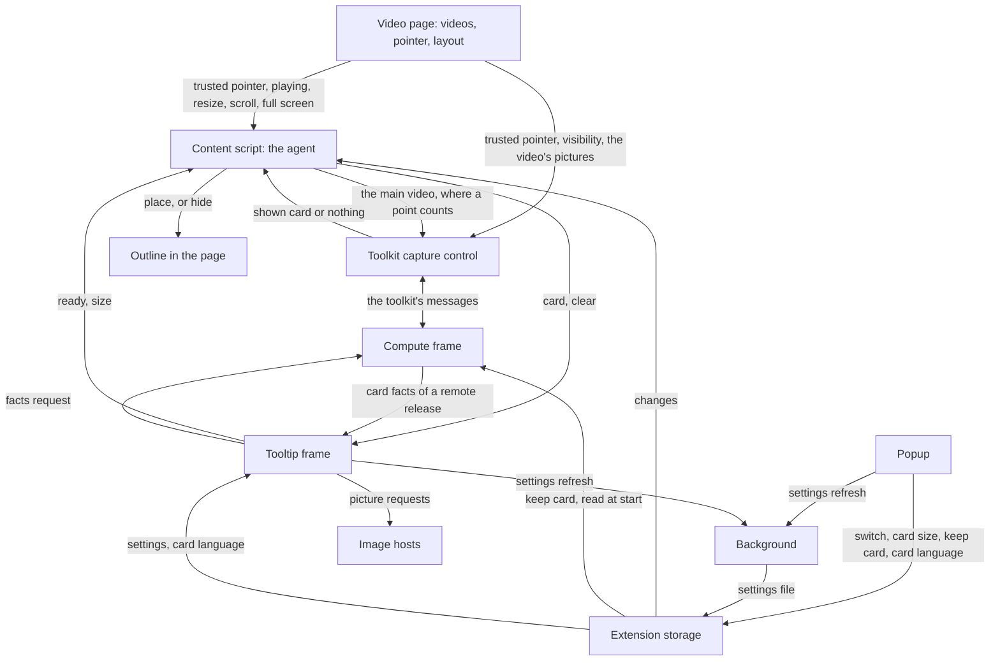

| Element | Anchors | Spec |
| --- | --- | --- |
| Content script: the agent | `src/content/index.ts`, `src/content/agent.ts#Agent`, `src/content/agent.ts#Agent.start`, `src/content/agent.ts#Agent.stop` | |
| The control listens to the page itself | `src/content/agent.ts#Agent.start` | S-B1, S-B6 |
| Hands the video to the capture control | `src/content/agent.ts#Agent.attachVideo`, `src/content/agent.ts#Agent.eligibleAt` | S-B5, S-B6 |
| The control's shown card and status | `src/content/agent.ts#Agent.start` | |
| Messages from the frames | `src/content/agent.ts#Agent.onMessage`, `src/shared/messages.ts#parseTooltipOut` | S-B9 |
| Compute frame | `src/compute/compute.ts`, `src/compute/session-options.ts#SESSION_OPTIONS` | S-X2, S-X3 |
| Which pages a frame serves | `src/shared/messages.ts#allowedParentOrigin` | S-B9 |
| Content script to tooltip frame | `src/shared/messages.ts#TooltipIn`, `src/shared/messages.ts#TooltipOut`, `src/shared/messages.ts#TooltipSize`, `src/shared/messages.ts#tag`, `src/shared/messages.ts#TAG` | S-B9 |
| Tooltip frame | `src/tooltip/tooltip.ts`, `src/tooltip/controller.ts#TooltipController`, `src/tooltip/controller.ts#connectTooltipFrame` | S-B9 |
| The facts channel | `src/shared/messages.ts#FACTS_CHANNEL`, `src/shared/messages.ts#CardFactsMessage`, `src/shared/messages.ts#FactsRequest`, `src/shared/messages.ts#parseCardFacts`, `src/shared/messages.ts#parseFactsRequest`, `src/compute/facts.ts#createShownFacts` | |
| Outline in the page | `src/content/outline.ts#CardOutline` | S-F1 |
| Popup | `src/popup/popup.ts`, `src/popup/view.ts#initPopup`, `src/popup/card-size-control.ts#initCardSize`, `src/popup/keep-card-control.ts#initKeepCard` | S-H1, S-H2 |
| Storage keys | `src/shared/enabled.ts#ENABLED_KEY`, `src/shared/card-size.ts#CARD_SIZE_KEY`, `src/shared/keep-card.ts#KEEP_CARD_KEY` | S-H1, S-H2 |
| Changes reach the agent | `src/content/storage-changes.ts#applyStorageChanges`, `src/content/storage-changes.ts#SettingsTarget` | S-H1, S-H3 |
| Keep card, read at start | `src/compute/session-options.ts#storedSessionOptions`, `src/shared/keep-card.ts#readKeepCard` | S-H2 |
| Background and the settings file | `src/background/index.ts`, `src/settings/store.ts#refreshSettings` | |
| Picture requests | `src/images/chain.ts#resolveCardImage`, `src/images/chain.ts#loadImage` | |

### 1b. Who owns which frame

The page holds two frames of the extension and one element of the content script's own. The agent
makes and removes all three; the capture control only asks for the frames after an idle unload.

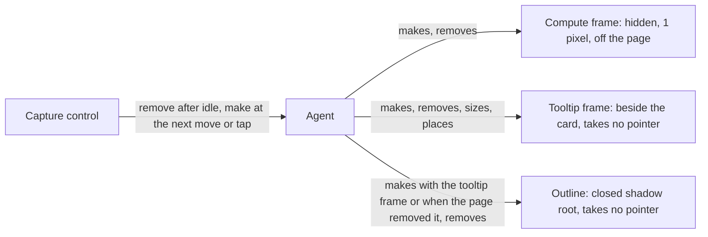

| Element | Anchors | Spec |
| --- | --- | --- |
| Compute frame element | `src/content/agent.ts#Agent.createCompute` | S-X3 |
| Tooltip frame element | `src/content/agent.ts#Agent.createTooltip`, `src/content/agent.ts#Agent.mountHost` | |
| Outline element | `src/content/outline.ts#CardOutline`, `src/content/outline.ts#outlineEdgeStyle`, `src/content/agent.ts#Agent.showTooltip` | S-F1 |
| Idle remove and make | `src/content/agent.ts#Agent.removeFrames`, `src/content/agent.ts#Agent.makeFrames` | S-A4, S-A6 |

## Layer 2: the decision points

### 2a. How does this page load hovers?

The address alone decides one of three outcomes: no hovers, hovers that load when the main video
plays, or hovers that load at the first trusted pointer over the picture. The build's config can
turn either site off, and then its pages get no hovers.

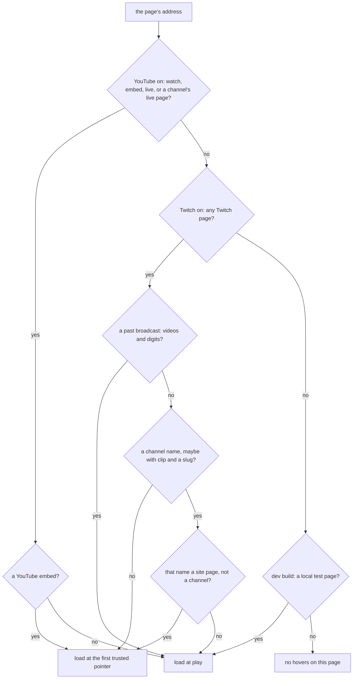

| Element | Anchors | Spec |
| --- | --- | --- |
| Active pages | `src/content/site.ts#isActivePage`, `src/content/site.ts#CHANNEL_LIVE`, `src/constants.ts#VIDEO_SITES` | S-G1 |
| Load at play | `src/content/site.ts#loadsAtPlay`, `src/content/agent.ts#Agent.pageLoadsAtPlay` | S-G2, S-G3 (differs) |
| Twitch player pages and site pages | `src/content/site.ts#TWITCH_PLAYER_PAGE`, `src/content/site.ts#TWITCH_SITE_PAGES` | S-G3 (differs) |

S-G3 names seven side pages. This code keeps its own longer list, which leaves out two of the
seven (`/following` and `/creatorcamp`), so those two load at play here.

### 2b. Which video is the main one?

The main video is the largest one on show. It is picked again on a pointer event, and on a
playing event where hovers are on and the page loads at play. It is kept for a second between
picks, unless a video started playing.

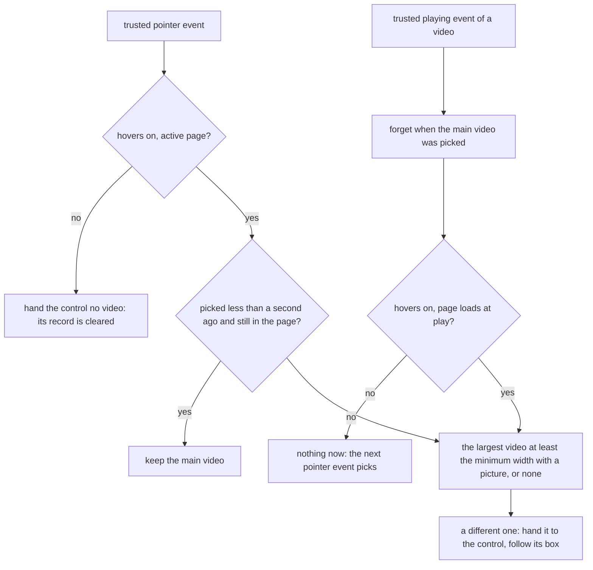

| Element | Anchors | Spec |
| --- | --- | --- |
| The main video | `src/content/agent.ts#Agent.currentVideo`, `src/content/agent.ts#VIDEO_RECHECK_MS` | S-G4 |
| On a pointer event | `src/content/agent.ts#Agent.onPointer` | S-G4 |
| On a playing event | `src/content/agent.ts#Agent.onPlaying`, `src/content/agent.ts#Agent.loadAtPlay`, `src/content/agent.ts#Agent.remakeRemovedAtPlay` | S-G4 |
| Hand to the control, follow its box | `src/content/agent.ts#Agent.attachVideo`, `src/content/agent.ts#Agent.onLayout` | S-B6 |

### 2c. Does a point count?

The capture control asks this at every pointer event and again before every capture. It never
picks the video again; it checks against the main video as last picked.

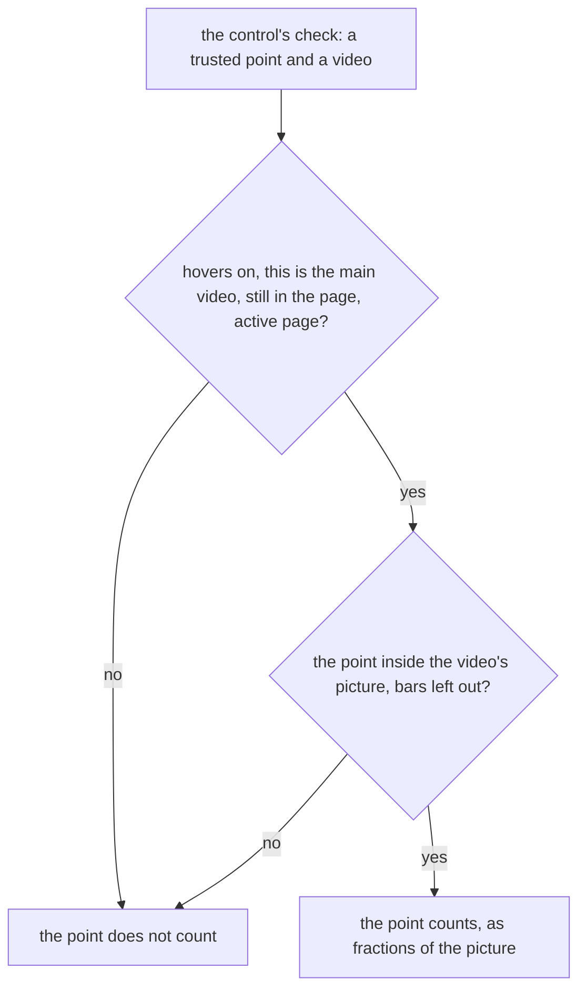

| Element | Anchors | Spec |
| --- | --- | --- |
| Where a point counts | `src/content/agent.ts#Agent.eligibleAt` | S-B5, S-B11, S-G1, S-G5 |
| The picture inside the element | `src/content/agent.ts#Agent.pictureOf`, `src/content/geometry.ts#pictureRect`, `src/content/geometry.ts#fractionIn` | S-B5 |

### 2d. When are the frames made and removed?

This is the life of the two frames as the agent sees it. The compute frame's own states inside a
live frame (loading, ready, idle, restarting) are in the toolkit's map, diagram 1c. While the
frames are removed after the idle time, a video that plays again makes nothing; only the viewer's
move or tap does. Turning hovers on leads to None, and from there a main video already playing on
a load-at-play page makes the frames at once.

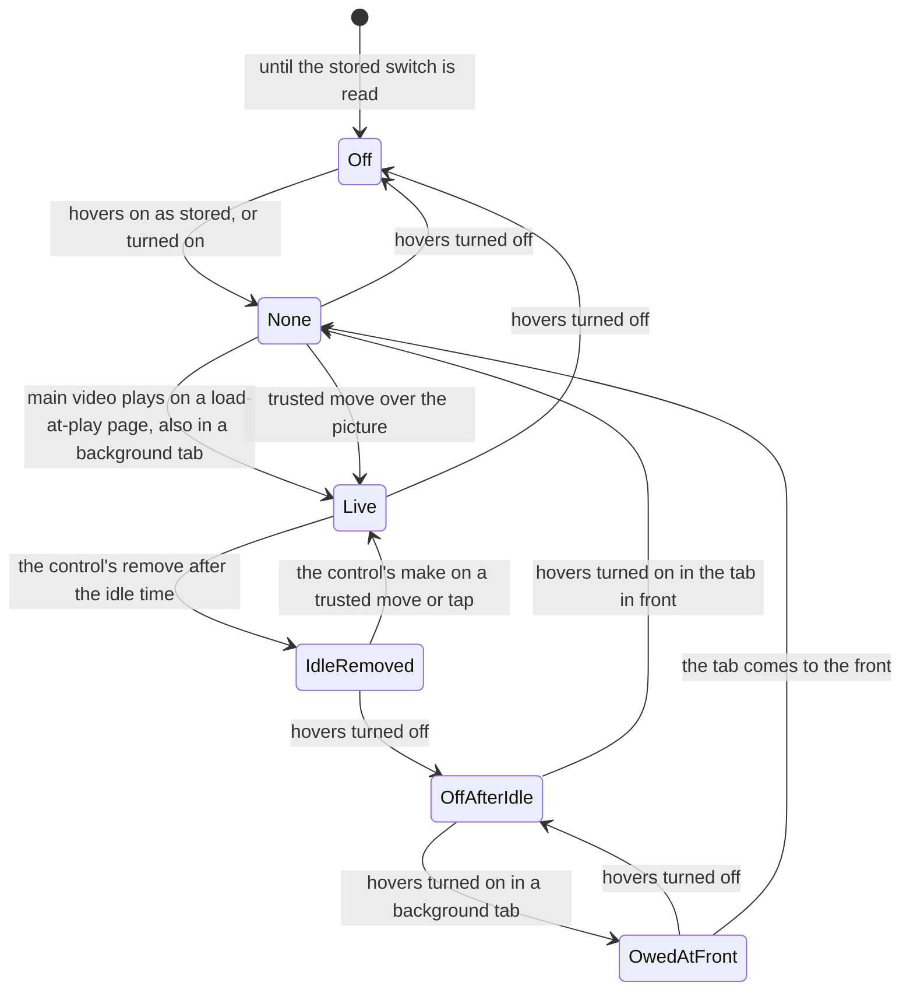

| Element | Anchors | Spec |
| --- | --- | --- |
| Off until the switch is read | `src/content/index.ts`, `src/shared/enabled.ts#readEnabled` | S-H1 |
| Made at play | `src/content/agent.ts#Agent.loadAtPlay`, `src/content/agent.ts#Agent.onPlaying` | S-A1, S-A8 (differs), S-B8 |
| Made at the first trusted move | `src/content/agent.ts#Agent.onPointer`, `src/content/agent.ts#Agent.ensureFrames` | S-A2 |
| Removed after the idle time, made at the next move or tap | `src/content/agent.ts#Agent.removeFrames`, `src/content/agent.ts#Agent.makeFrames` | S-A4, S-A6 |
| Turned on and off | `src/content/agent.ts#Agent.setEnabled`, `src/content/agent.ts#Agent.reloadAfterSwitch`, `src/content/agent.ts#Agent.teardown` | S-A7, S-H1, S-B11 |
| Owed until the front | `src/content/agent.ts#Agent.onVisibility`, `src/content/agent.ts#Agent.setEnabled` | S-A7 |

S-A8 says a video that starts playing in a background tab waits for the tab to come to the front
before it loads. This code loads it at play in a background tab too.

### 2e. When is one frame made again?

Three causes make a single frame again while the others stay: the page deleted it, "Keep the card
I'm pointing at" turned over, or full screen changed. A keep-card change owed to a background tab
is checked again when the tab comes to the front; a compute frame made meanwhile already read the
new hold, and nothing is owed.

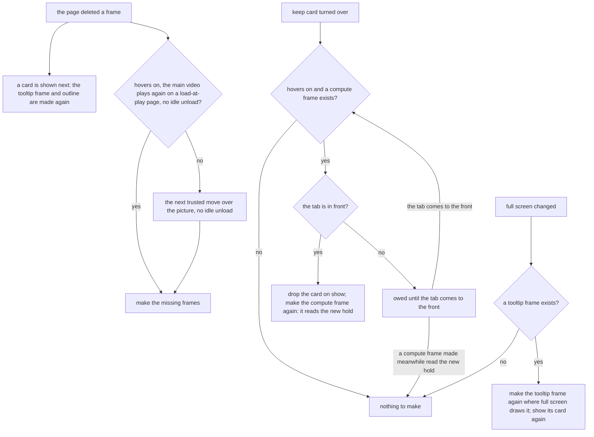

Full screen draws the tooltip frame inside the full-screen element, or in the page itself when
leaving full screen or when the full-screen element is a video or a frame.

| Element | Anchors | Spec |
| --- | --- | --- |
| A deleted frame, at play | `src/content/agent.ts#Agent.remakeRemovedAtPlay`, `src/content/agent.ts#Agent.ensureFrames` | S-A10 (differs) |
| A deleted frame, at the next move | `src/content/agent.ts#Agent.onPointer` | S-A10 (differs) |
| A deleted tooltip frame or outline, at the next card | `src/content/agent.ts#Agent.showTooltip` | |
| Keep card turned over | `src/shared/keep-card.ts#keepCardChanged`, `src/content/agent.ts#Agent.restartForKeepCard`, `src/content/agent.ts#Agent.onVisibility`, `src/content/agent.ts#Agent.createCompute` | S-H3 |
| The hold the new frame reads | `src/compute/session-options.ts#sessionOptions`, `src/compute/session-options.ts#storedSessionOptions` | S-H2, S-W4, S-W6 |
| Full screen | `src/content/agent.ts#Agent.onFullscreen`, `src/content/agent.ts#Agent.mountHost` | |

S-A10 says both frames are made again. This code makes only the frame that is missing.

### 2f. Is the tooltip shown?

The capture control reports each shown card, or nothing. The tooltip shows while a card is shown
and the control's record says the viewer's pointer is over the picture; otherwise it goes after a
short delay, unless both hold again by then.

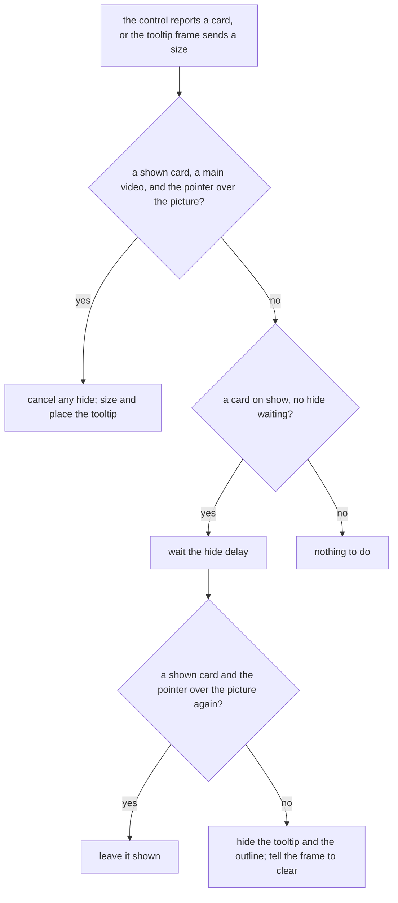

| Element | Anchors | Spec |
| --- | --- | --- |
| The decision | `src/content/agent.ts#Agent.updateTooltip`, `src/content/agent.ts#HIDE_DELAY_MS` | |
| The pointer over the picture, in the control's record | `src/content/agent.ts#Agent.pointing` | S-B6 |
| Hide | `src/content/agent.ts#Agent.hideTooltip` | S-F1 |

### 2g. How big is the tooltip?

The tooltip frame reports its own size and shape: card-shaped (the picture, or the dark card with
the name while the picture loads) or a pill with the name. The agent sizes it each time it shows
or moves the tooltip.

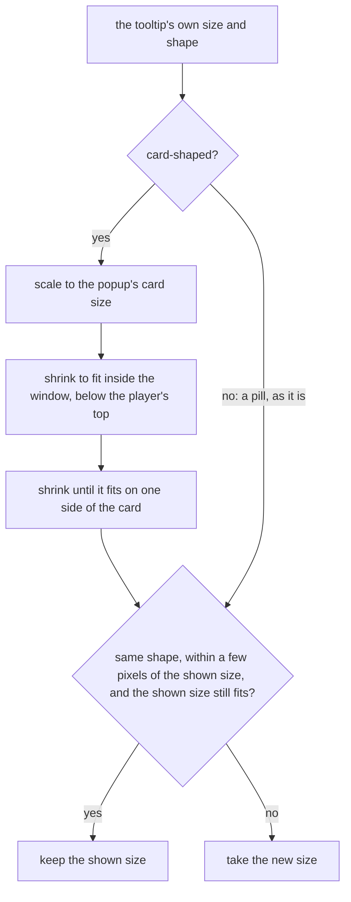

| Element | Anchors | Spec |
| --- | --- | --- |
| Size and place | `src/content/agent.ts#Agent.showTooltip`, `src/content/agent.ts#SIZE_HYSTERESIS_PX` | |
| The card size | `src/content/agent.ts#Agent.setCardSize`, `src/content/geometry.ts#scaleTooltipSize`, `src/shared/card-size.ts#clampCardSize`, `src/shared/card-size.ts#readCardSize` | |
| Fit in the window | `src/content/geometry.ts#fitTooltipSize`, `src/content/geometry.ts#availableSpace`, `src/content/geometry.ts#MIN_ART_WIDTH` | |
| Fit beside the card | `src/content/geometry.ts#fitBesideCard` | |
| Corners | `src/content/geometry.ts#tooltipRadius` | |

### 2h. Where does the tooltip go?

Of six places beside, below or above the card, the agent takes the one off the card that covers
the least area of the other cards. A tooltip already shown stays where it is unless another place
is clearly better, so it does not jump. "Where it is" moves with the card when the same card
moved on screen.

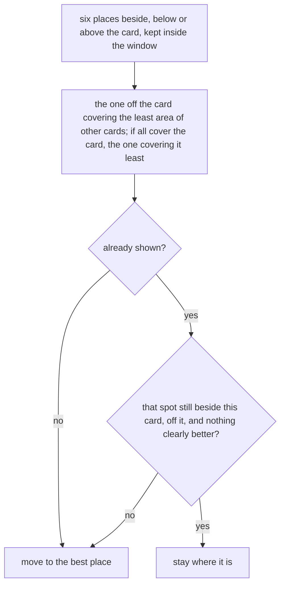

| Element | Anchors | Spec |
| --- | --- | --- |
| Where it was | `src/content/agent.ts#Agent.showTooltip` | |
| The places and the choice | `src/content/geometry.ts#placeTooltipAvoiding`, `src/content/geometry.ts#clearlyBetter`, `src/content/geometry.ts#STICKY_PX`, `src/content/geometry.ts#CARD_PAD` | |
| Placed again when the page moves | `src/content/agent.ts#Agent.onLayout`, `src/content/agent.ts#Agent.onScroll` | |

### 2i. What outline is drawn?

The outline is the shown card's box on the picture, turned with the card when the compute frame
sent a turned outline. It shows only once the tooltip shows, and a card the reading hold marked
`held` has none.

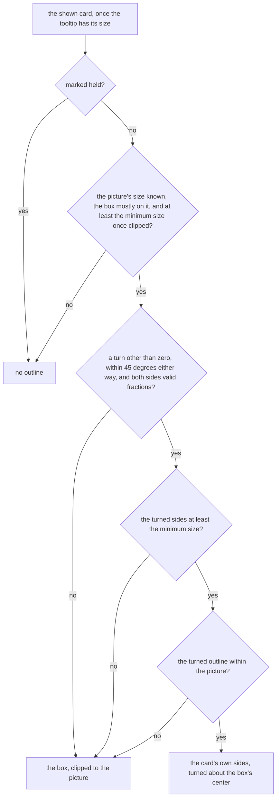

| Element | Anchors | Spec |
| --- | --- | --- |
| When it is asked | `src/content/agent.ts#Agent.showTooltip` | S-F1, S-F4, S-W7 |
| The box on the picture | `src/content/outline.ts#outlineRect`, `src/content/outline.ts#MIN_OUTLINE_SIDE` | S-F1 |
| A turned card | `src/content/outline.ts#outlinePlace`, `src/content/outline.ts#OutlinedCard`, `src/content/outline.ts#OutlinePlace` | S-F2, S-F3 (differs) |
| Turned outlines are asked for | `src/compute/session-options.ts#SESSION_OPTIONS` | S-F2 |
| Drawn and hidden | `src/content/outline.ts#CardOutline.show`, `src/content/outline.ts#CardOutline.hide`, `src/content/outline.ts#OUTLINE_FADE_MS` | S-F1 |

S-F3 says a turned card's outline is always turned. This code draws the upright box instead when
the turned outline would reach past the picture.

### 2j. What does the tooltip frame draw?

The tooltip frame is told a card id, never what to draw: the page's name for the card is never
shown. It finds the card's facts, then shows the card's picture, or its name in a pill when there
is no picture. Each card it shows asks the background for a settings refresh, which the background
makes at most once an hour.

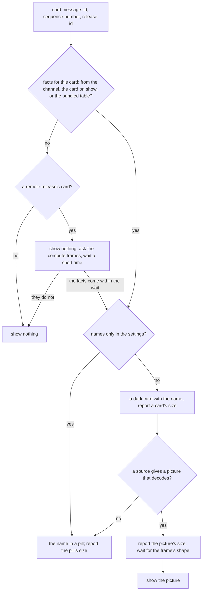

| Element | Anchors | Spec |
| --- | --- | --- |
| Only the page that embeds it | `src/tooltip/controller.ts#connectTooltipFrame`, `src/shared/messages.ts#parseTooltipIn` | S-B9 |
| Show and clear | `src/tooltip/controller.ts#TooltipController.show`, `src/tooltip/controller.ts#TooltipController.clear` | |
| Which facts | `src/tooltip/controller.ts#TooltipController.lookup`, `src/tooltip/controller.ts#knownCard`, `src/tooltip/controller.ts#TooltipController.addFacts`, `src/tooltip/controller.ts#FACTS_WAIT_MS` | |
| The bundled table | `src/tooltip/card-data.ts#parseSourceFileMaps`, `src/tooltip/card-data.ts#CardFacts` | |
| The pill | `src/tooltip/controller.ts#TooltipController.showPill` | |
| The picture's sources in order | `src/tooltip/controller.ts#TooltipController.resolve`, `src/images/chain.ts#resolveCardImage`, `src/images/chain.ts#SourceHealth`, `src/images/chain.ts#loadImage` | |
| Sizes | `src/tooltip/controller.ts#artSize`, `src/tooltip/controller.ts#CARD_ASPECT` | |
| The frame's shape | `src/tooltip/frame-shape.ts#frameHasShape`, `src/tooltip/frame-shape.ts#FRAME_SHAPE_TIMEOUT_MS` | |
| New settings | `src/tooltip/controller.ts#TooltipController.setSettings`, `src/tooltip/controller.ts#TooltipController.setLocalized` | |

## Layer 3: flows

### 3a. A shown card becomes a tooltip

The compute frame named a card under the pointer. The tooltip frame first sizes itself as a dark
card with the name, which is when the agent shows it. Meanwhile the picture loads, and it replaces
the dark card once the frame has the picture's shape.

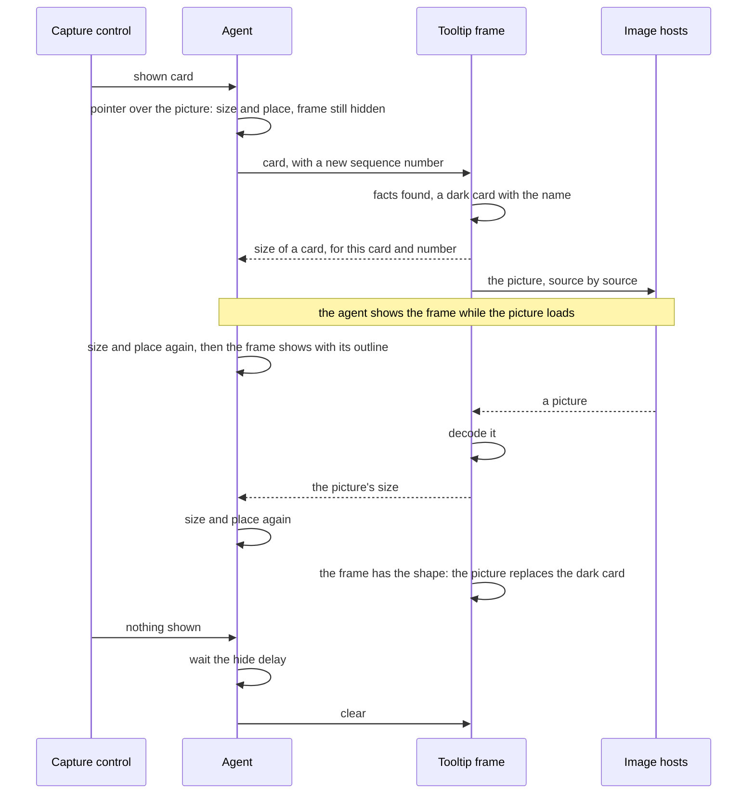

| Step | Anchors | Spec |
| --- | --- | --- |
| The shown card arrives | `src/content/agent.ts#Agent.start`, `src/content/agent.ts#Agent.updateTooltip` | |
| Sent to the tooltip frame | `src/content/agent.ts#Agent.toTooltip`, `src/content/agent.ts#Agent.showTooltip` | |
| The frame shows once sized for this card | `src/content/agent.ts#Agent.onMessage`, `src/content/agent.ts#Agent.showTooltip` | |
| A size from an earlier card or showing is dropped | `src/content/agent.ts#Agent.onMessage` | |
| The picture | `src/tooltip/controller.ts#TooltipController.show`, `src/images/chain.ts#resolveCardImage` | |
| The frame's shape first | `src/tooltip/frame-shape.ts#frameHasShape` | |
| Hidden after the delay | `src/content/agent.ts#Agent.updateTooltip`, `src/content/agent.ts#Agent.hideTooltip` | |

### 3b. A card of a remote release

When the settings file names a remote release, its cards may have facts the bundled table does
not. They go from the compute frame to the tooltip frame over an extension-only channel, never
through the page. A tooltip frame that does not have a card's facts asks for them.

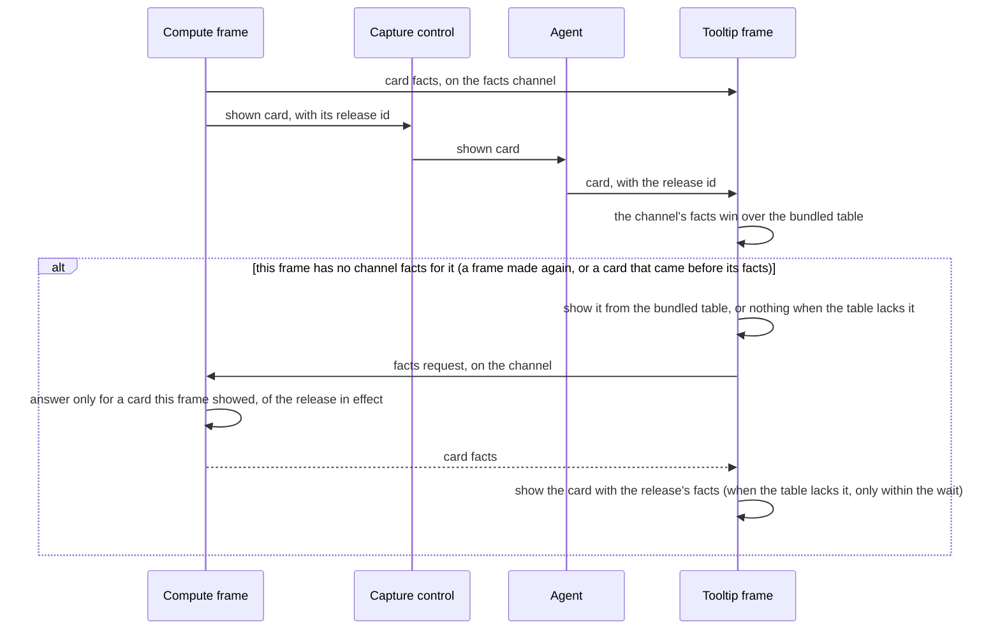

| Step | Anchors | Spec |
| --- | --- | --- |
| Facts before the card | `src/compute/facts.ts#createShownFacts`, `src/compute/facts.ts#ShownFacts`, `src/compute/compute.ts` | |
| Only cards this frame showed | `src/compute/facts.ts#createShownFacts`, `src/compute/facts.ts#SHOWN_IDS_LIMIT` | |
| The tooltip frame takes them | `src/tooltip/tooltip.ts`, `src/shared/messages.ts#parseCardFacts`, `src/tooltip/controller.ts#TooltipController.addFacts`, `src/tooltip/controller.ts#FACTS_LIMIT` | |
| The request and the wait | `src/tooltip/controller.ts#TooltipController.show`, `src/tooltip/controller.ts#FACTS_WAIT_MS`, `src/shared/messages.ts#parseFactsRequest` | |

## Coverage

These files are the map's coverage. Each must carry at least one anchor above, and a change to
one of them updates this page in the same pull request. Not covered: the vendored runtime (the
toolkit's map), how a release is chosen and loaded, how the settings file is read and checked, the
card language and its pictures, and the update notice.

- `src/background/index.ts`
- `src/compute/compute.ts`
- `src/compute/facts.ts`
- `src/compute/session-options.ts`
- `src/content/agent.ts`
- `src/content/geometry.ts`
- `src/content/index.ts`
- `src/content/outline.ts`
- `src/content/site.ts`
- `src/content/storage-changes.ts`
- `src/images/chain.ts`
- `src/popup/card-size-control.ts`
- `src/popup/keep-card-control.ts`
- `src/popup/popup.ts`
- `src/popup/view.ts`
- `src/shared/card-size.ts`
- `src/shared/enabled.ts`
- `src/shared/keep-card.ts`
- `src/shared/messages.ts`
- `src/tooltip/card-data.ts`
- `src/tooltip/controller.ts`
- `src/tooltip/frame-shape.ts`
- `src/tooltip/tooltip.ts`
