<!-- SPDX-License-Identifier: Apache-2.0 -->

# Hover map

This is a map of Kenbunshoku's own hover code: what it tells the toolkit's shared hover host, how
the compute frame is started, and how a card named by the runtime becomes a tooltip on screen. It
covers the files listed under [Coverage](#coverage) and nothing else.

Most of a hover's work in the page is the toolkit's, vendored in `vendor/cardvision-browser/`:

- **The runtime** decides when to take a picture, when to analyze it and which card to name. It
  has its own map:
  [the toolkit's hover map](https://github.com/ryangswe/riftsight-vision/blob/9ece68a/docs/hover-map.md),
  at the commit vendored here (named in `vendor/cardvision-browser/cardvision-vendor.json`). This
  page does not redraw it.
- **The shared hover host** (`host-content.js`, `host-compute.js` and `host-settings.js`, one file
  per realm; experimental in the toolkit) decides the rest of what used to be this extension's
  content script: which pages are active and when each loads, which video is the main one, the
  pointer authority, when the two frames are made and removed (the switch, a background tab, the
  idle unload, a frame the page removed, keep-card), the outline, and when a card is shown and
  hidden. Its source is the toolkit's `browser/src/host/`. The toolkit's map at this commit does
  not draw it yet, so this page draws it only as a box, with the clauses it carries out.

The rules, one clause per behavior, are in the toolkit's
[hover spec](https://github.com/ryangswe/riftsight-vision/blob/9ece68a13428b012684ee7d3d1dbf8dfae7608d7/docs/hover-spec.md),
at the commit vendored here. Its list of clauses is vendored as
`vendor/cardvision-browser/hover-spec.json`. This page shows the structure and the flows: which
part decides what, and in what order the parts talk. It does not repeat the rules; each element
links the clause that states its rule.

**Checked by `test/hover-map.test.ts`.** Every anchor below must name a file that exists and a
symbol that file defines, every clause id must exist in the vendored clause list, and every
covered file must be anchored at least once. The test checks names. It does not check behavior: a
diagram can be wrong while its names are right, so a change to a covered file updates this page
in the same pull request, and the reviewer reads the diagram.

## How to read it

The map has three layers, from the whole to the detail.

1. **The parts.** These diagrams show who runs where, and what they send each other.
2. **Decision points.** These are the questions Kenbunshoku's own code asks: what the host is
   told, how the compute frame starts, whether the tooltip frame has measured itself for the card,
   how big the tooltip is and where it goes, which of the tooltip frame's messages count, and what
   the tooltip frame draws.
3. **Flows.** Three cases are drawn as sequence diagrams: a shown card becoming a tooltip, a new
   tooltip frame, and a card of a remote release.

Under each diagram a table lists its elements. Each row names an element or a part of one, the
anchors of its code, and the spec clauses it carries out.

- An anchor is `` `src/<folder>/<file>.ts#<symbol>` ``. A symbol is a function, class, constant,
  type or interface, or `Class.member` for a method or a function-valued field of that class. The
  compute frame, the tooltip frame, the popup and the background run their setup at the top of
  the file or in one unnamed function, so their anchors name the file alone.
- A clause is written `S-G3` and is defined in the hover spec. A clause the host carries out is
  cited on the row of the code that hands the host what it needs. A clause followed by
  "(differs)" would state a rule that this code does not meet yet, one the spec marks as changing
  in a product release. None is marked: the host meets them.
- Times and thresholds are in the spec and the code, not here.

The diagrams follow two rules:

- **One diagram answers one question.** A diagram that answers two is split, however small. A big
  diagram that answers one question stays whole; about 15 nodes is a prompt to check whether it
  answers two, not a limit.
- **Overview first, then detail.** Layer 1 is the overview. Layers 2 and 3 zoom in. Each split
  follows a seam in the code: a separate policy, phase or component.

On GitHub, a diagram taller than its frame can be zoomed, moved, or opened full screen from the
buttons that appear over it.

## Layer 1: the parts

### 1a. Who talks to whom

The content script starts the hover host in the video page with the extension's config and the
tooltip's adapter. The host listens to the page, holds the pointer authority, takes the pictures,
talks to the compute frame (the toolkit's map covers that conversation), and calls the adapter to
size, place and fill the tooltip frame. The compute frame, started by the host's compute half,
names the card. The popup's settings reach every part through the extension's storage.

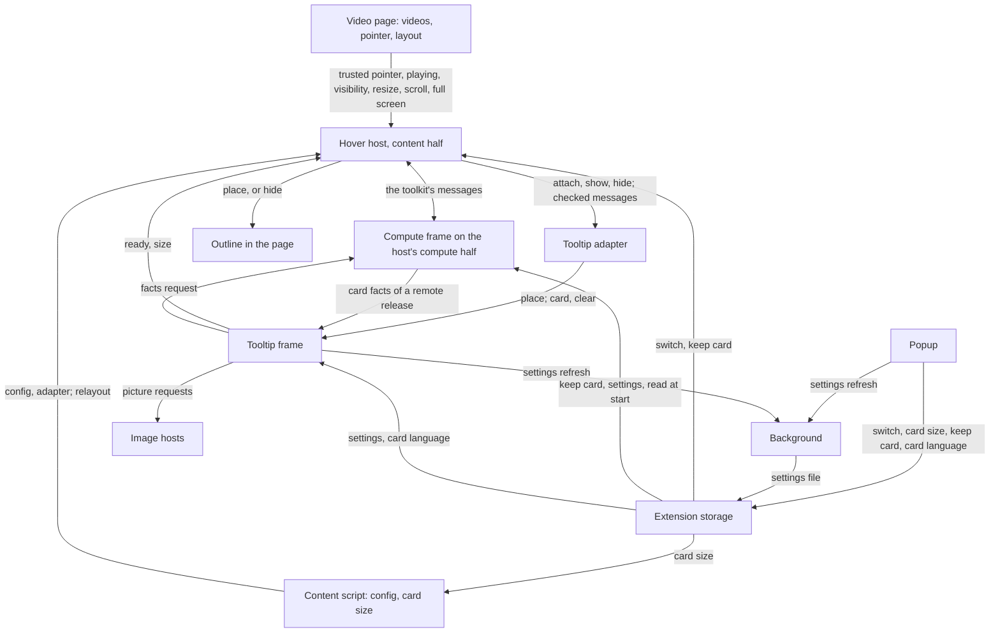

| Element | Anchors | Spec |
| --- | --- | --- |
| Content script | `src/content/index.ts`, `src/content/index.ts#host`, `src/content/index.ts#view` | |
| What the host is told | `src/shared/product.ts#productConfig`, `src/shared/product.ts#COMPUTE_PAGE`, `src/shared/product.ts#TOOLTIP_PAGE` | S-A3, S-G1 |
| The card size, the adapter's own input | `src/content/card-size-sync.ts#syncCardSize`, `src/content/tooltip-view.ts#TooltipView.setCardSize`, `src/shared/card-size.ts#readCardSize`, `src/shared/card-size.ts#CARD_SIZE_KEY` | |
| Tooltip adapter | `src/content/tooltip-view.ts#TooltipView` | S-B9 |
| Content script to tooltip frame | `src/shared/messages.ts#TooltipIn`, `src/shared/messages.ts#TooltipOut`, `src/shared/messages.ts#TooltipSize`, `src/shared/messages.ts#tag`, `src/shared/messages.ts#TAG` | S-B9 |
| Compute frame | `src/compute/compute.ts` | S-X2, S-X3 |
| Tooltip frame | `src/tooltip/tooltip.ts`, `src/tooltip/controller.ts#TooltipController`, `src/tooltip/controller.ts#connectTooltipFrame` | S-B9 |
| The facts channel | `src/shared/messages.ts#FACTS_CHANNEL`, `src/shared/messages.ts#CardFactsMessage`, `src/shared/messages.ts#FactsRequest`, `src/shared/messages.ts#parseCardFacts`, `src/shared/messages.ts#parseFactsRequest`, `src/compute/facts.ts#createShownFacts` | |
| Popup | `src/popup/popup.ts`, `src/popup/view.ts#initPopup`, `src/popup/card-size-control.ts#initCardSize`, `src/popup/keep-card-control.ts#initKeepCard` | S-H1, S-H2 |
| The popup reads the switches as the host does | `src/popup/view.ts#NO_CHANGES` | S-H1, S-H2 |
| Background and the settings file | `src/background/index.ts`, `src/settings/core.ts#settingsCore` | |
| Picture requests | `src/images/chain.ts#resolveCardImage`, `src/images/chain.ts#loadImage` | |

### 1b. Who owns which frame

The page holds two frames of the extension and the outline. The host makes, moves and removes all
three, and keeps the tooltip frame's visibility, stacking and pointer-events. The adapter only
places the tooltip frame and posts to it, through the narrow handle the host gives it.

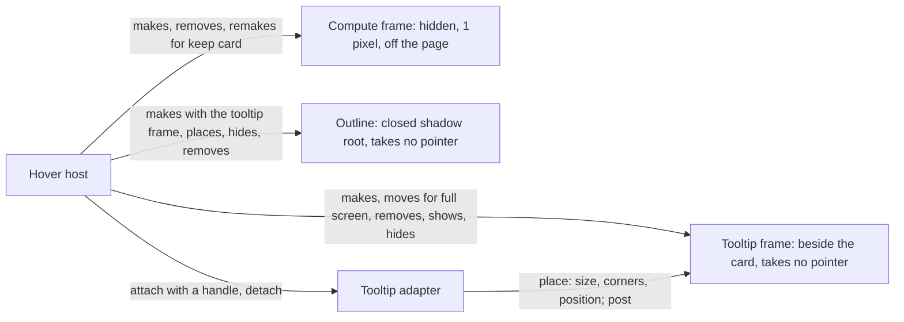

| Element | Anchors | Spec |
| --- | --- | --- |
| The two pages the host makes as frames | `src/shared/product.ts#COMPUTE_PAGE`, `src/shared/product.ts#TOOLTIP_PAGE` | S-A1, S-A2, S-A4, S-A6, S-A10, S-H3 |
| A new tooltip frame, and one gone | `src/content/tooltip-view.ts#TooltipView.attach`, `src/content/tooltip-view.ts#TooltipView.detach`, `src/content/tooltip-view.ts#TooltipView.forget` | S-B11 |
| The frame's look | `src/content/tooltip-view.ts#TooltipView` | |
| The outline's marker and colors | `src/shared/product.ts#productConfig`, `src/constants.ts#OUTLINE_COLOR`, `src/constants.ts#OUTLINE_GLOW_COLOR` | S-F1, S-F2, S-F3, S-F4 |

## Layer 2: the decision points

### 2a. What does the host need to know?

One function gives each realm the same config, with that build's development flag. The host takes
from it the pages it serves and when each loads, the frames it makes, the outline it draws and
the compute frame's options; the tooltip frame checks the page that embeds it against the same
sites.

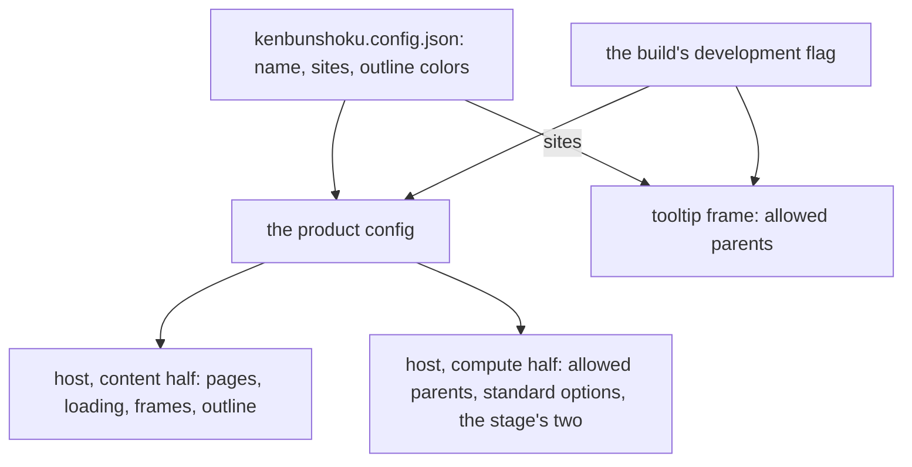

| Element | Anchors | Spec |
| --- | --- | --- |
| The config | `src/shared/product.ts#productConfig`, `src/constants.ts#VIDEO_SITES`, `src/config.ts#CONFIG` | S-G1, S-G2, S-G3, S-G5 |
| The geometric stage's capability | `src/shared/product.ts#productConfig` | S-A3 |
| The tooltip frame's parent check | `src/tooltip/controller.ts#connectTooltipFrame` | S-B9 |

### 2b. How does the compute frame start?

The host's compute half checks the page that embeds the frame first, and nothing is read for a
page this build does not serve. Then it asks this extension for the load request, reads keep-card
for the hold, and starts the toolkit's compute frame with the standard options.

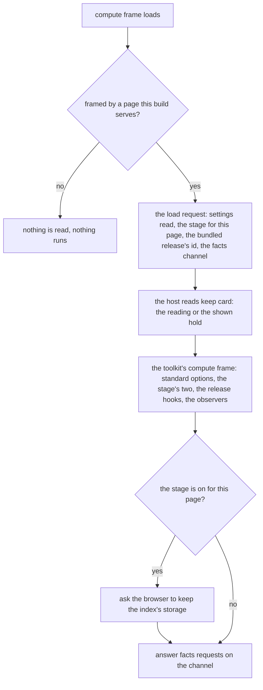

| Element | Anchors | Spec |
| --- | --- | --- |
| The start | `src/compute/compute.ts` | S-B9, S-X3 |
| The stage for this page | `src/compute/load-request.ts#stageForPage`, `src/compute/load-request.ts#geometricOption` | S-A3 |
| The load request | `src/compute/load-request.ts#buildLoadRequest`, `src/compute/load-request.ts#LoadRequest` | S-X2 |
| The settings in effect | `src/settings/schema.ts#settingsSchema` | |
| The idle unload, shortened in a development build | `src/compute/compute.ts` | S-A4 |

### 2c. Is the tooltip frame ready to show the card?

The host decides when a card is shown and when it goes (a short delay after the pointer no
longer holds authority over a card). It shows the frame and the outline only when the adapter
says the frame has measured itself for this card, so the frame never shows a previous card or the
wrong shape.

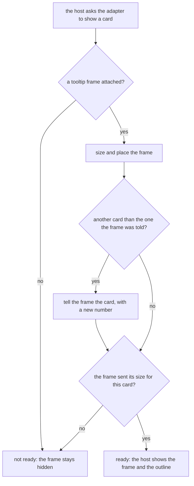

| Element | Anchors | Spec |
| --- | --- | --- |
| The answer | `src/content/tooltip-view.ts#TooltipView.show` | S-F1, S-F4, S-W7 |
| Told, or held until the frame is ready | `src/content/tooltip-view.ts#TooltipView.toTooltip` | |
| The card goes | `src/content/tooltip-view.ts#TooltipView.hide` | S-F1 |

### 2d. How big is the tooltip?

The tooltip frame reports its own size and shape: card-shaped (the picture, or the dark card with
the name while the picture loads) or a pill with the name. The adapter sizes it each time the host
shows or moves the card. A new frame starts at the size last shown, as a card.

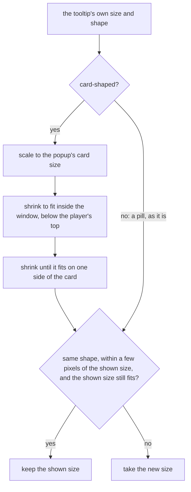

| Element | Anchors | Spec |
| --- | --- | --- |
| Size and place | `src/content/tooltip-view.ts#TooltipView.show`, `src/content/tooltip-view.ts#SIZE_HYSTERESIS_PX`, `src/content/tooltip-view.ts#INITIAL_SIZE` | |
| The card size | `src/content/tooltip-view.ts#TooltipView.setCardSize`, `src/content/geometry.ts#scaleTooltipSize`, `src/shared/card-size.ts#clampCardSize`, `src/shared/card-size.ts#readCardSize` | |
| Fit in the window | `src/content/geometry.ts#fitTooltipSize`, `src/content/geometry.ts#availableSpace`, `src/content/geometry.ts#MIN_ART_WIDTH` | |
| Fit beside the card | `src/content/geometry.ts#fitBesideCard` | |
| Corners | `src/content/geometry.ts#tooltipRadius` | |

### 2e. Where does the tooltip go?

Of six places beside, below or above the card, the adapter takes the one off the card that covers
the least area of the other cards. A tooltip already on show stays where the adapter last placed
it unless another place is clearly better, so it does not jump. "Where it is" moves with the card
when the same card moved on screen. The host hands over the picture, the card and the other cards
in page coordinates, and places the card again when the page moves.

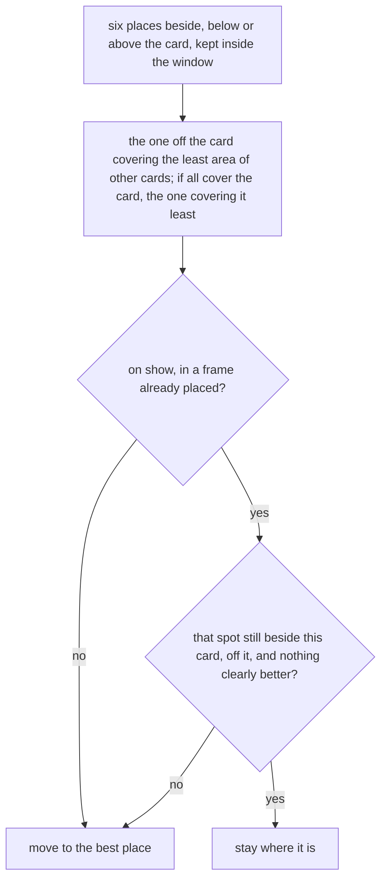

| Element | Anchors | Spec |
| --- | --- | --- |
| Where it was | `src/content/tooltip-view.ts#TooltipView.show` | |
| The places and the choice | `src/content/geometry.ts#placeTooltipAvoiding`, `src/content/geometry.ts#clearlyBetter`, `src/content/geometry.ts#STICKY_PX`, `src/content/geometry.ts#CARD_PAD` | |
| Placed again when the card size changes | `src/content/card-size-sync.ts#syncCardSize` | |

### 2f. Which of the tooltip frame's messages count?

The host takes a message from the tooltip frame only when the browser made it, from that frame's
window, at the extension's origin, and passes its data to the adapter. The adapter reads two
kinds; anything else is dropped.

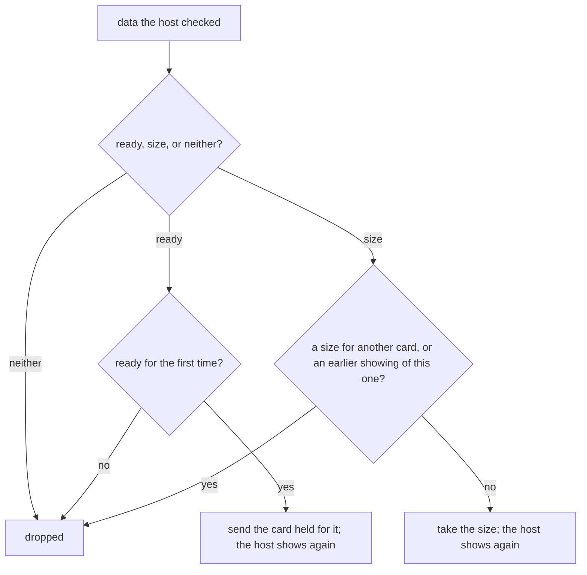

| Element | Anchors | Spec |
| --- | --- | --- |
| The adapter's reading | `src/content/tooltip-view.ts#TooltipView.message`, `src/shared/messages.ts#parseTooltipOut` | S-B9 |
| The card held for a frame not yet ready | `src/content/tooltip-view.ts#TooltipView.toTooltip` | |

### 2g. What does the tooltip frame draw?

The tooltip frame is told a card id, never what to draw: the page's name for the card is never
shown. It finds the card's facts, then shows the card's picture, or its name in a pill when there
is no picture. Each card it shows asks the background for a settings refresh, which the background
makes at most once an hour.

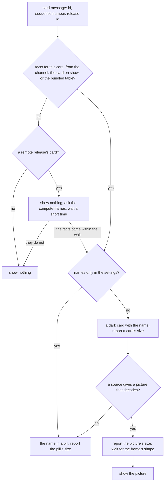

| Element | Anchors | Spec |
| --- | --- | --- |
| Only the page that embeds it | `src/tooltip/controller.ts#connectTooltipFrame`, `src/shared/messages.ts#parseTooltipIn` | S-B9 |
| Show and clear | `src/tooltip/controller.ts#TooltipController.show`, `src/tooltip/controller.ts#TooltipController.clear` | |
| Which facts | `src/tooltip/controller.ts#TooltipController.lookup`, `src/tooltip/controller.ts#knownCard`, `src/tooltip/controller.ts#TooltipController.addFacts`, `src/tooltip/controller.ts#FACTS_WAIT_MS` | |
| The bundled table | `src/tooltip/card-data.ts#parseSourceFileMaps`, `src/tooltip/card-data.ts#CardFacts` | |
| The pill | `src/tooltip/controller.ts#TooltipController.showPill` | |
| The picture's sources in order | `src/tooltip/controller.ts#TooltipController.resolve`, `src/images/chain.ts#resolveCardImage`, `src/images/chain.ts#SourceHealth`, `src/images/chain.ts#loadImage` | |
| Sizes | `src/tooltip/controller.ts#artSize`, `src/tooltip/controller.ts#CARD_ASPECT` | |
| The frame's shape | `src/tooltip/frame-shape.ts#frameHasShape`, `src/tooltip/frame-shape.ts#FRAME_SHAPE_TIMEOUT_MS` | |
| New settings | `src/tooltip/controller.ts#TooltipController.setSettings`, `src/tooltip/controller.ts#TooltipController.setLocalized`, `src/settings/core.ts#sameSettings` | |

## Layer 3: flows

### 3a. A shown card becomes a tooltip

The compute frame named a card under the pointer. The tooltip frame first sizes itself as a dark
card with the name, which is when the host shows it. Meanwhile the picture loads, and it replaces
the dark card once the frame has the picture's shape.

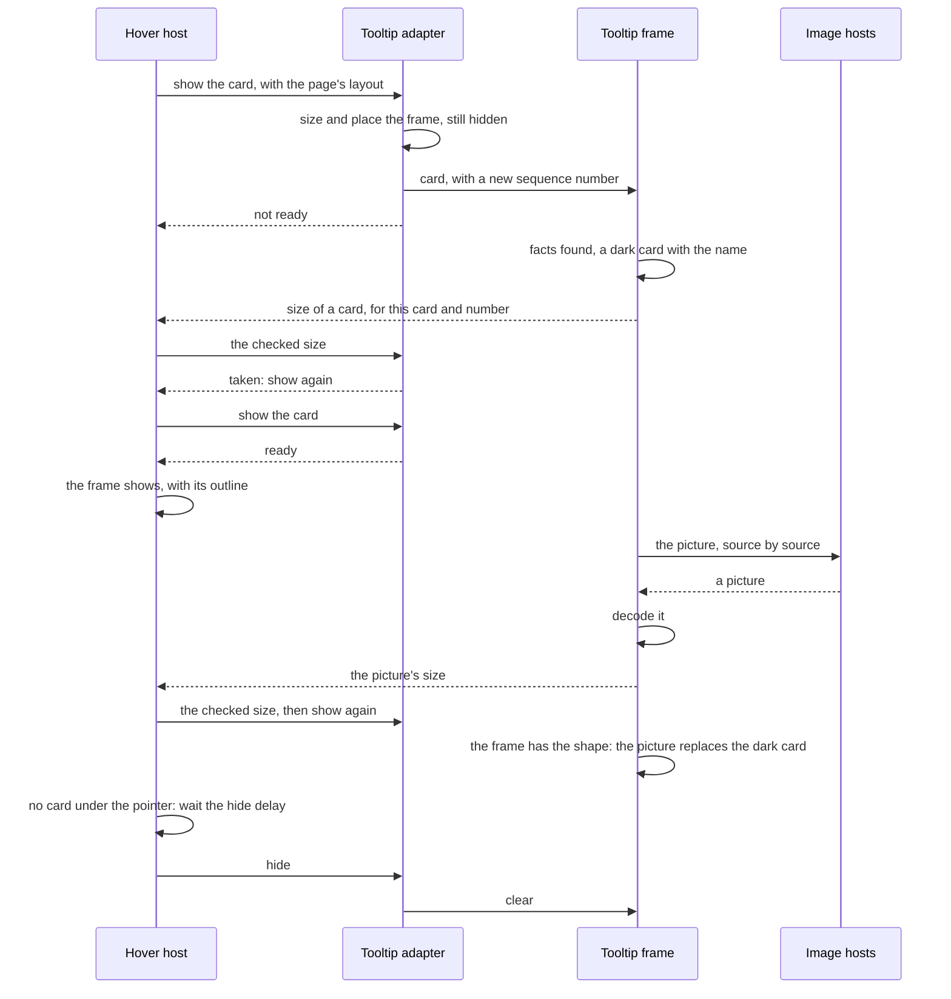

| Step | Anchors | Spec |
| --- | --- | --- |
| Sized, placed and told | `src/content/tooltip-view.ts#TooltipView.show`, `src/content/tooltip-view.ts#TooltipView.toTooltip` | |
| The frame shows once sized for this card | `src/content/tooltip-view.ts#TooltipView.message`, `src/content/tooltip-view.ts#TooltipView.show` | S-F1 |
| A size from an earlier card or showing is dropped | `src/content/tooltip-view.ts#TooltipView.message` | |
| The picture | `src/tooltip/controller.ts#TooltipController.show`, `src/images/chain.ts#resolveCardImage` | |
| The frame's shape first | `src/tooltip/frame-shape.ts#frameHasShape` | |
| Cleared after the delay | `src/content/tooltip-view.ts#TooltipView.hide` | |

### 3b. A new tooltip frame

The host makes a new tooltip frame when it first makes the frames, after an idle unload, when full
screen changes, and when the page removed the frame (then at the next trusted play on a page that
loads at play, the next trusted pointer over the picture, or the next card to show). Straight after
attaching it, the host shows the card on show, or held on a paused video, again, with no new card
needed.

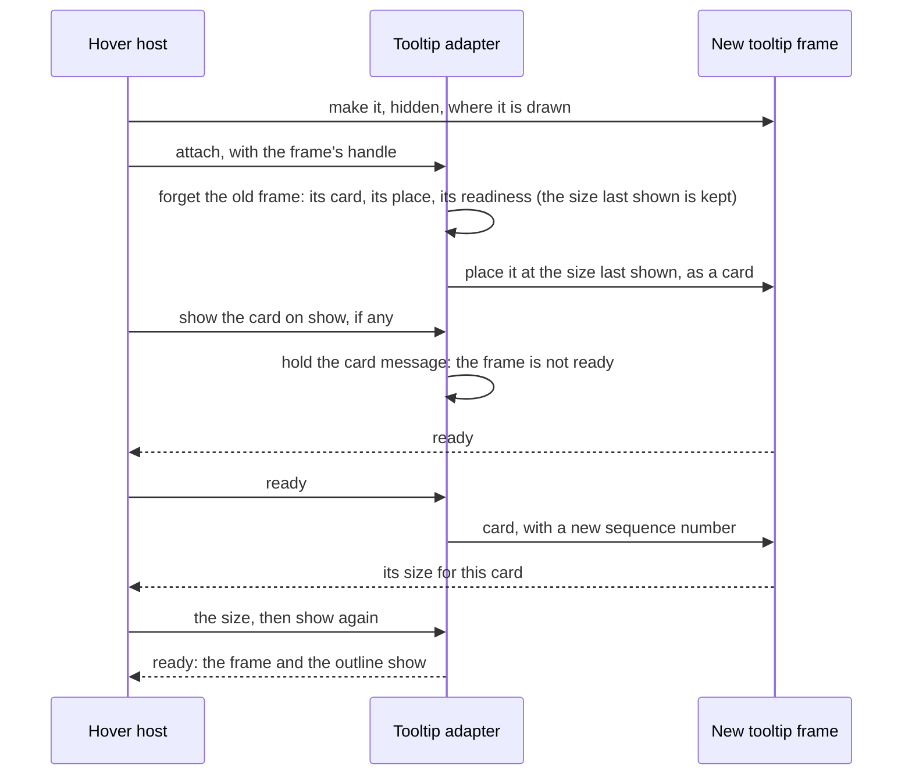

| Step | Anchors | Spec |
| --- | --- | --- |
| Attach, and the first size | `src/content/tooltip-view.ts#TooltipView.attach`, `src/content/tooltip-view.ts#INITIAL_SIZE` | S-A10 |
| The card held until ready | `src/content/tooltip-view.ts#TooltipView.toTooltip`, `src/content/tooltip-view.ts#TooltipView.message` | |

### 3c. A card of a remote release

When the settings file names a remote release, its cards may have facts the bundled table does
not. They go from the compute frame to the tooltip frame over an extension-only channel, never
through the page. A tooltip frame that does not have a card's facts asks for them.

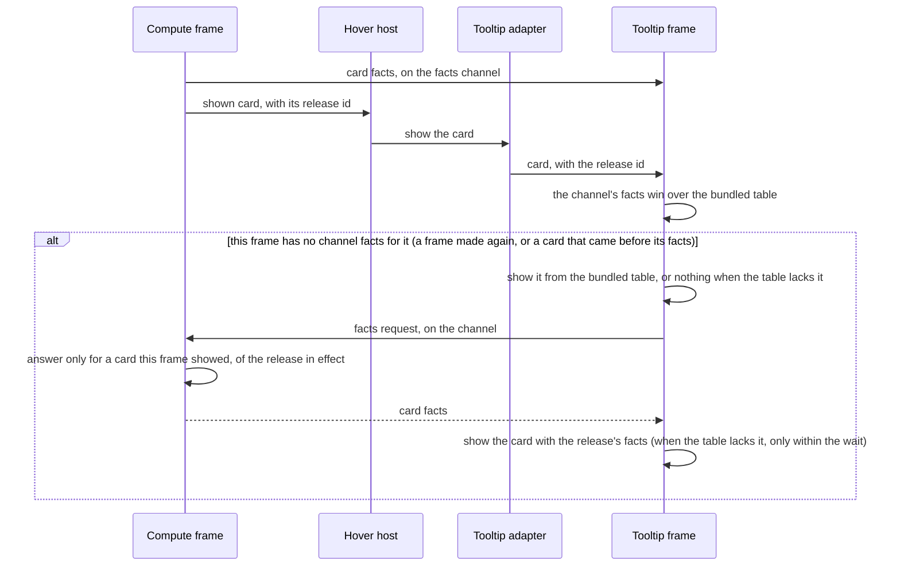

| Step | Anchors | Spec |
| --- | --- | --- |
| Facts before the card | `src/compute/facts.ts#createShownFacts`, `src/compute/facts.ts#ShownFacts`, `src/compute/compute.ts` | |
| Only cards this frame showed | `src/compute/facts.ts#createShownFacts`, `src/compute/facts.ts#SHOWN_IDS_LIMIT` | |
| The tooltip frame takes them | `src/tooltip/tooltip.ts`, `src/shared/messages.ts#parseCardFacts`, `src/tooltip/controller.ts#TooltipController.addFacts`, `src/tooltip/controller.ts#FACTS_LIMIT` | |
| The request and the wait | `src/tooltip/controller.ts#TooltipController.show`, `src/tooltip/controller.ts#FACTS_WAIT_MS`, `src/shared/messages.ts#parseFactsRequest` | |

## Coverage

These files are the map's coverage. Each must carry at least one anchor above, and a change to
one of them updates this page in the same pull request. Not covered: the vendored runtime (the
toolkit's map) and its hover host (the toolkit's `browser/src/host/`), how a release is chosen and
loaded, how the settings file is checked, the card language and its pictures, and the update
notice.

- `src/background/index.ts`
- `src/compute/compute.ts`
- `src/compute/facts.ts`
- `src/compute/load-request.ts`
- `src/content/card-size-sync.ts`
- `src/content/geometry.ts`
- `src/content/index.ts`
- `src/content/tooltip-view.ts`
- `src/images/chain.ts`
- `src/popup/card-size-control.ts`
- `src/popup/keep-card-control.ts`
- `src/popup/popup.ts`
- `src/popup/view.ts`
- `src/settings/core.ts`
- `src/shared/card-size.ts`
- `src/shared/messages.ts`
- `src/shared/product.ts`
- `src/tooltip/card-data.ts`
- `src/tooltip/controller.ts`
- `src/tooltip/frame-shape.ts`
- `src/tooltip/tooltip.ts`
