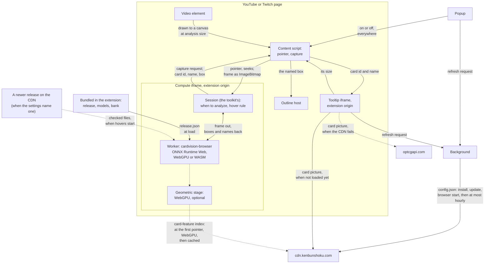

<!-- SPDX-License-Identifier: Apache-2.0 -->
# How it works

The extension's parts and the settings file that controls where card pictures come from. For building and changing it, see [development.md](development.md).

*[Back to README](../README.md)*

## Overview

The extension is built on an open-source card recognition runtime,
`cardvision-browser` (Apache-2.0; see [Built on cardvision](../README.md#built-on-cardvision)), and a One
Piece Card Game release of its models: a detector that finds cards in the picture and a
recognizer that matches each card against a bank of known cards, with an accept rule that shows
nothing when the match is not clear.

- The **content script** (`src/content/`) runs in YouTube and Twitch pages. It follows the
  page's main video and the pointer over it, and captures a picture when asked.
- A hidden **compute frame** (`src/compute/`), an extension page inside the video page, hosts
  the runtime's worker. It decides when to analyze a picture (only around pointer activity,
  with the runtime's scheduler), and which card a tooltip shows at the pointer (the runtime's
  hover rule). How long a shown card stays is the runtime's hold, picked when the frame starts by
  the popup's **Keep the card I'm pointing at** (`sessionOptions` in
  `src/compute/session-options.ts`): on, the reading hold (`READING_HOLD`) keeps the card while the
  pointer stays where it was seen, and the content script hides the outline of a card marked
  `held`; off, the shown hold (`SHOWN_HOLD`) keeps it through short gaps. A change makes a running
  compute frame again, at once in the tab in front and in a background tab when it next comes to
  the front. Pictures go from the content script to this frame only.
- The **tooltip frame** (`src/tooltip/`), an extension page placed beside the card, shows its
  picture alone (320 px wide, scaled down to fit the window but not below 200 px), or its name
  when there is no picture. It takes no pointer events.
- The **background** (`src/background/`) fetches the settings file.
- The runtime's **geometric stage** (WebGPU only) checks recognized cards against their art's
  ORB features, using OpenCV.js and a packed card-feature index on the CDN. An analysis checks
  only the card under the pointer and the boxes overlapping it, not every card in the picture
  (`geometricScope: "focus"`, set in `src/compute/session-options.ts`). A card the stage applies
  to and has not checked yet shows nothing until it is checked. On a still picture the next
  analysis checks every card, and the repeats after it reuse that analysis, so a later move to
  another card is answered from it. The compute frame
  passes the bundled stage settings (`data/geometric.json`, which names the index's manifest)
  and the manifest's pinned SHA-256 (`kenbunshoku.config.json`); the worker downloads the index once the
  release has loaded and the viewer first points at the picture, keeps it in the Cache API, checks every shard's SHA-256, and turns
  the stage off by itself when it is too slow or fails. The compute frame asks the browser to
  keep that storage (`navigator.storage.persist()`).

## Architecture

**How to read it.** Dashed arrows are the optional geometric stage and the picture fallback;
the rest is the base pipeline. An arrow into `cdn.kenbunshoku.com` or
`optcgapi.com` is a request, with its contents and its timing as in [PRIVACY.md](../PRIVACY.md).

- **The content script** is on for all supported videos (the popup's switch is the sole
  control). It makes both frames, and so loads the model, when the page's main video plays (the
  toolkit's `loadWhen`, once per video element), or at the first pointer move over a video that has
  not played. A video playing loads the model only on pages that are for watching
  (`loadsAtPlay` in `site.ts`): not in an embedded YouTube player, which on another website may be
  a muted video that plays by itself, and on Twitch only on a channel's page, a past broadcast or
  a clip. Elsewhere, such as Twitch's front page with its featured stream, only the pointer does.
  The main video is picked by size, and a featured stream is the largest video on its page, so the
  page rule, not the size, keeps it from loading.
  A video playing in a background tab loads the model too, with no visibility filter. Loading
  reads no picture: the tab going to the background ends the hover, and coming back does not
  restore it until the browser reports the pointer over the video again. From then on it reports
  the pointer and seeks to the compute frame,
  and, when asked and the pointer is active over the player, draws the video to a canvas at
  analysis size and transfers it as an `ImageBitmap`.
  After 10 idle minutes (the pointer not moved over the picture, no card shown, no analysis in
  flight) the compute frame ends its worker and the content script removes both frames, giving
  their memory back; the next pointer move over the picture makes them again, and the video
  playing on does not (toolkit 0.12.0, `idleUnloadMs` and `whenIdle`). Card hovers turned off
  and on in the popup start afresh: a playing main video loads them at once, as it does before
  any unload.
- **The compute frame** decides when to analyze and runs the hover rule; its worker runs the
  vendored runtime on the release bundled in the extension, or on a newer release the settings
  file names (the toolkit's remote-release module, vendored): the frame downloads that release's files once, checks each against
  its SHA-256, reuses the bundled files that are the same, and falls back to the bundled release on
  any problem. Frames, pictures and results never go to the network. The worker also downloads the
  card-feature index of the optional geometric stage, once the release has loaded and the viewer
  has first pointed at the picture (`geometricLoad: "pointer"`, also after an idle unload), and
  keeps it in Cache Storage; a newer release names its own index. With a newer release, the frame also sends
  each shown card's name to the tooltip frame over a channel the page cannot reach.
- **The tooltip frame** gets a card id and name, loads the card's picture (from the CDN, then
  `optcgapi.com` if the CDN fails, or none with `namesOnly`), and reports its size back. The
  content script places it, and draws the **outline** around the same box, turned with the card
  when the compute frame sends the card's turned outline.
- **The background** fetches the settings file. The popup and the tooltip frame ask it for a
  refresh, which it makes at most once an hour.

## The settings file

Where pictures come from is decided by a small settings file at
`https://cdn.kenbunshoku.com/config.json` (schema version 1), so that images can be switched to
another source, or off, without a new extension release:

- `namesOnly: true` shows no pictures at all: the card's name only.
- `geometric: false` (optional; absent means on) turns the extra-accuracy stage off: the
  card-feature file is not downloaded, from the next page a video is hovered on.
- `primary` is the project's own image server; `fallbacks` are tried in order when it fails
  (an error, a body that is not a picture, or no picture within 5 seconds); with none left, the
  tooltip shows the card's name.
- `release` names a newer card-recognition release on the same host (its id, path and SHA-256, the
  lowest extension version that may load it, and its card-feature index), so that new cards reach
  installs without a store update. See "The release pointer" in [cdn/SETTINGS.md](../cdn/SETTINGS.md).
- `cardLink` is obsolete: the tooltip has no link. A file may still carry it; it is ignored.

The file is checked strictly. A file that cannot be used leaves the last good copy in effect, or
the copy built into the extension. An image source on a host the extension has no permission
for is ignored (adding a host needs a new release). The extension also reads an optional
`update: { "latest": "x.y.z", "url": "https://…" }` field: when the running version is lower,
the popup shows one dismissible "New version available" line. The address must be on the
project's releases page; any other is ignored.
