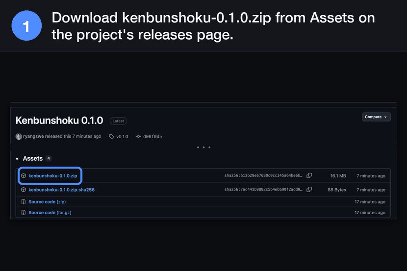
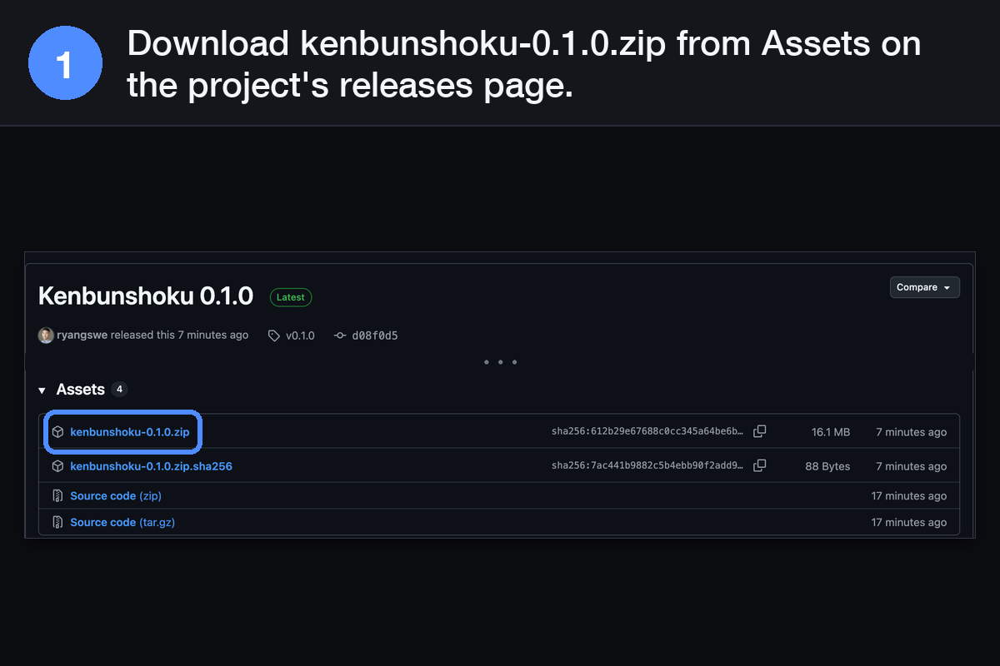
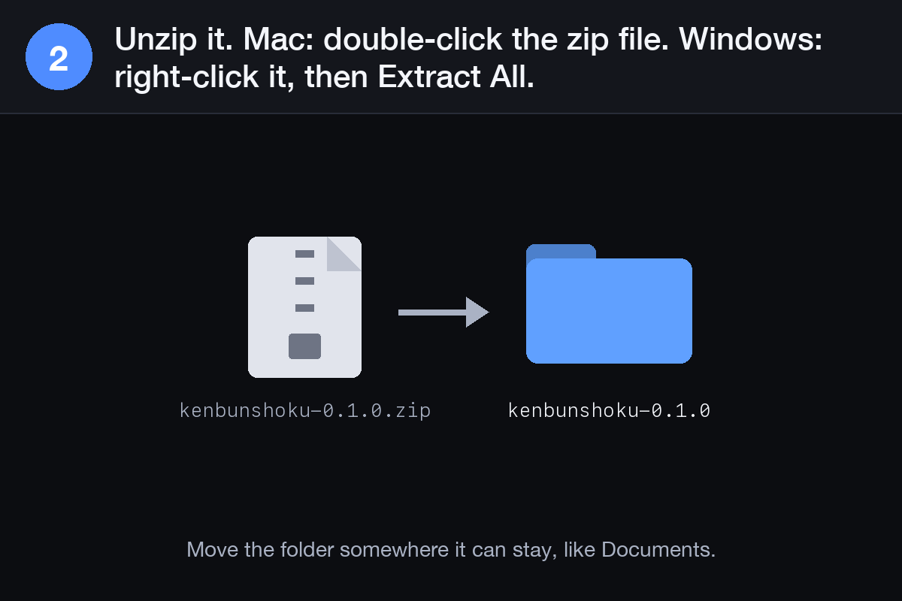
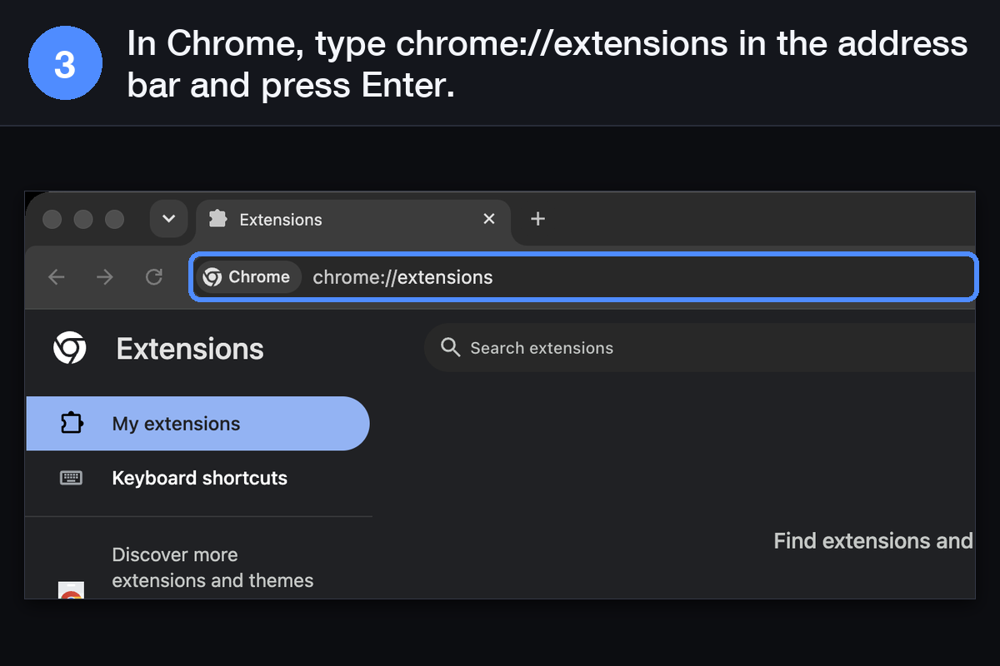
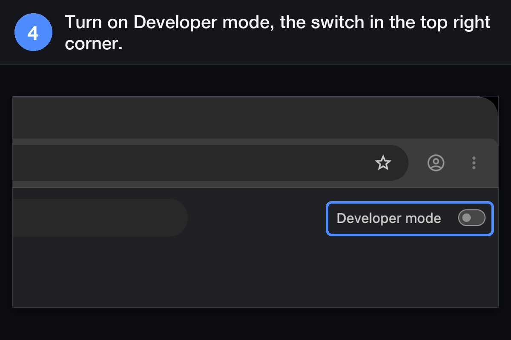
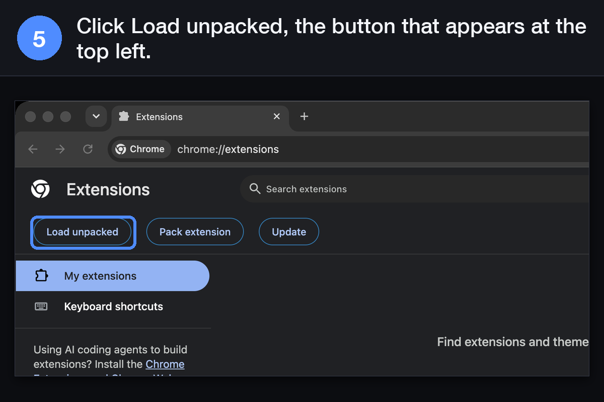
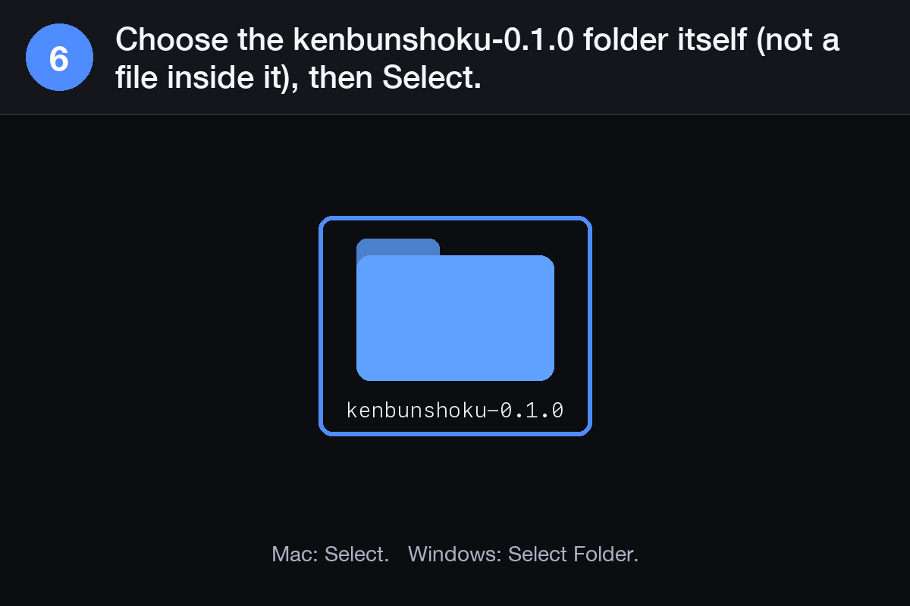
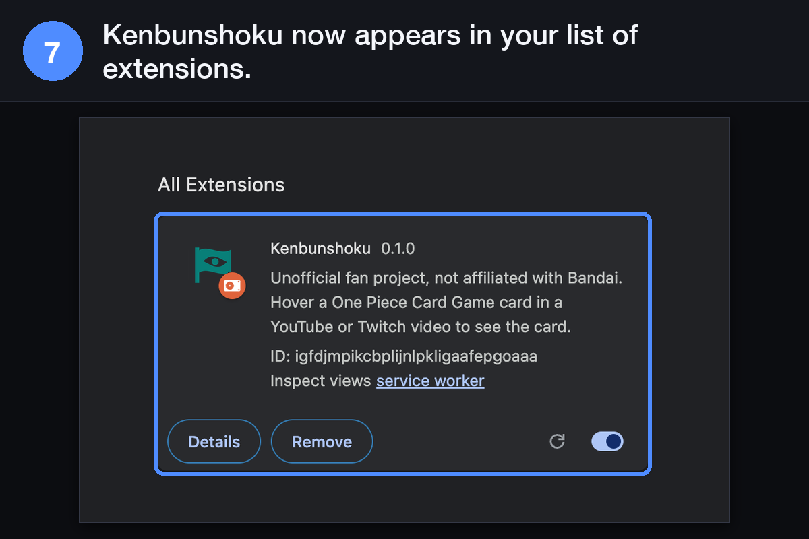
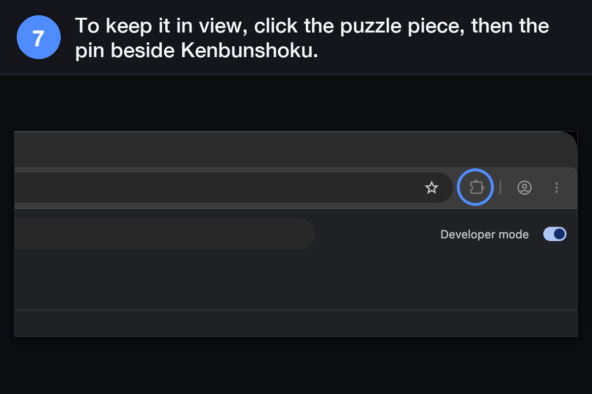
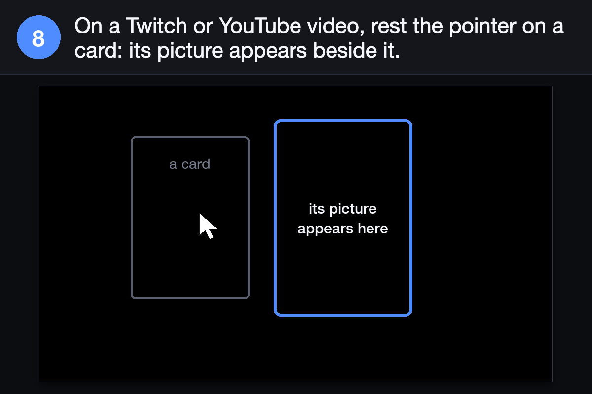

<!-- SPDX-License-Identifier: Apache-2.0 -->
# Install from a release zip (Load unpacked)

Most people should install Kenbunshoku from the [Chrome Web Store](https://chromewebstore.google.com/detail/kenbunshoku/gndfmgcngfebiiiioddngmifddjiiabf): one click, and Chrome keeps it
up to date. In Firefox, install it from addons.mozilla.org instead (see [Firefox](#firefox) below).
This page is for the other cases in Chrome: a Chrome setup that can't use the Web Store,
trying a release before it reaches the store, or learning how to load an extension you build
yourself (**Load unpacked**), for example a [fork for another card game](make-it-yours.md). It takes a few
minutes, and a zip install does not update itself.

1. Open the project's [releases page](https://github.com/ryangswe/kenbunshoku/releases) and,
   under the newest release, download the file named `kenbunshoku-<version>.zip`.

   

2. Unzip it: double-click the file on a Mac, or right-click it and choose **Extract All** on
   Windows. You get a folder named `kenbunshoku-<version>`. Move that folder somewhere it can stay,
   for example your Documents folder. Chrome loads the extension from it each time it starts, so
   do not delete it.

   

3. In Chrome, open a new tab, type `chrome://extensions` in the address bar and press Enter.

   

4. Turn on **Developer mode**, the switch in the top right corner of that page.

   

5. Click **Load unpacked**, the button that appears at the top left.

   

6. Choose the `kenbunshoku-<version>` folder from step 2 (the folder itself, not a file inside
   it) and click **Select**.

   

7. Kenbunshoku appears in the list. To keep its button in view, click the puzzle-piece icon to
   the right of the address bar, then the pin beside **Kenbunshoku**.

   

   

8. Open a One Piece Card Game video on Twitch or YouTube and rest the pointer on a card: its
   picture appears beside it (see [Using Kenbunshoku](using.md)).

   

Chrome may show a notice about extensions in developer mode when it starts. That is normal for
an extension installed this way; choose to keep it.

To update without losing your settings, or to remove it, see
[Updating and removing](using.md#updating-and-removing).

## Firefox

The zip on the releases page is the Chrome build; it is not made for Firefox. In Firefox, install
Kenbunshoku from [addons.mozilla.org](https://addons.mozilla.org/firefox/addon/kenbunshoku/)
(Firefox 148 or later on desktop), and Firefox keeps it up to date. Release versions of Firefox
keep an add-on installed for good when Mozilla has signed it and refuse one that is not signed.
Nothing on the releases page is signed for Firefox.

To try a build of your own in Firefox, build it for Firefox and load it as a temporary add-on, as
the [developer guide](development.md#firefox) describes. Firefox removes a temporary add-on when
you quit Firefox.
